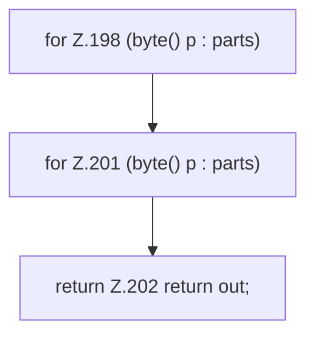

[[00 Start]] › [[Dashboard-HTTP]] › [[HTTP-Klassen]] › [[HttpsSupport]] › [[HttpsSupport.Teil2]] › [[HttpsSupport.concat]]

# HttpsSupport.concat

`HttpsSupport.concat(byte[]... parts)` [src/main/java/de/aichele/childlauncher/HttpsSupport.java:196–203](https://github.com/Sciddie/minecraft-serverhoster-plugin/blob/95b02b953b0b4c23673e900e021a7c3c844aa37d/src/main/java/de/aichele/childlauncher/HttpsSupport.java#L196-L203)



```knoten
for Z.198 (byte() p : parts)
  Zeile 198: Schleife `(byte() p : parts)`.
for Z.201 (byte() p : parts)
  Zeile 201: Schleife `(byte() p : parts)`.
return Z.202 return out;
  Zeile 202: Rückgabe `return out;`.
```

- `concat` in `src/main/java/de/aichele/childlauncher/HttpsSupport.java`
