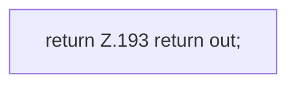

[[00 Start]] › [[Dashboard-HTTP]] › [[HTTP-Klassen]] › [[HttpsSupport]] › [[HttpsSupport.Teil2]] › [[HttpsSupport.derLen]] › [[HttpsSupport.derLen.Teil2]]

# HttpsSupport.derLen.Teil2



```knoten
return Z.193 return out;
  Zeile 193: Rückgabe `return out;`.
```

> [!knoten]- Was die Blöcke tun
> - **return Z.193 return out;**: Zeile 193: Rückgabe `return out;`.

- Ein weiterer Abschnitt derselben Übersicht.
- Fortsetzung von `HttpsSupport.derLen`.
