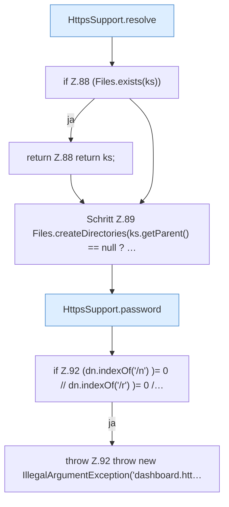

[[00 Start]] › [[Dashboard-HTTP]] › [[HTTP-Klassen]] › [[HttpsSupport]] › [[HttpsSupport.Teil1]] › [[HttpsSupport.ensureSelfSigned]] › [[HttpsSupport.ensureSelfSigned.Teil1]]

# HttpsSupport.ensureSelfSigned.Teil1



```knoten
HttpsSupport.resolve
  Dieser Teil bestimmt das. Löst auf `resolve`.
if Z.88 (Files.exists(ks))
  Zeile 88: prüft `(Files.exists(ks))`.
return Z.88 return ks;
  Zeile 88: Rückgabe `return ks;`.
Schritt Z.89 Files.createDirectories(ks.getParent() == null ? …
  Zeile 89: Dateioperation. `Files.createDirectories(ks.getParent() == null ? …`
HttpsSupport.password
  Dieser Teil macht hier einen einzelnen Schritt. Eine Ebene tiefer steht er genauer. `password` in `HttpsSupport.java`. Ruft `readOrCreatePass`.
if Z.92 (dn.indexOf('/n') )= 0 // dn.indexOf('/r') )= 0 /…
  Zeile 92: prüft `(dn.indexOf('/n') )= 0 // dn.indexOf('/r') )= 0 /…`.
throw Z.92 throw new IllegalArgumentException('dashboard.htt…
  Zeile 92: Abbruch `throw new IllegalArgumentException('dashboard.htt…`.
```

> [!knoten]- Was die Blöcke tun
> - **HttpsSupport.resolve**: Dieser Teil bestimmt das. Löst auf `resolve`.
> - **if Z.88 (Files.exists(ks))**: Zeile 88: prüft `(Files.exists(ks))`.
> - **return Z.88 return ks;**: Zeile 88: Rückgabe `return ks;`.
> - **Schritt Z.89 Files.createDirectories(ks.getParent() == null ? …**: Zeile 89: Dateioperation. `Files.createDirectories(ks.getParent() == null ? …`
> - **HttpsSupport.password**: Dieser Teil macht hier einen einzelnen Schritt. Eine Ebene tiefer steht er genauer. `password` in `HttpsSupport.java`. Ruft `readOrCreatePass`.
> - **if Z.92 (dn.indexOf('/n') )= 0 // dn.indexOf('/r') )= 0 /…**: Zeile 92: prüft `(dn.indexOf('/n') )= 0 // dn.indexOf('/r') )= 0 /…`.
> - **throw Z.92 throw new IllegalArgumentException('dashboard.htt…**: Zeile 92: Abbruch `throw new IllegalArgumentException('dashboard.htt…`.

- Ein weiterer Abschnitt derselben Übersicht.
- Fortsetzung von `HttpsSupport.ensureSelfSigned`.
