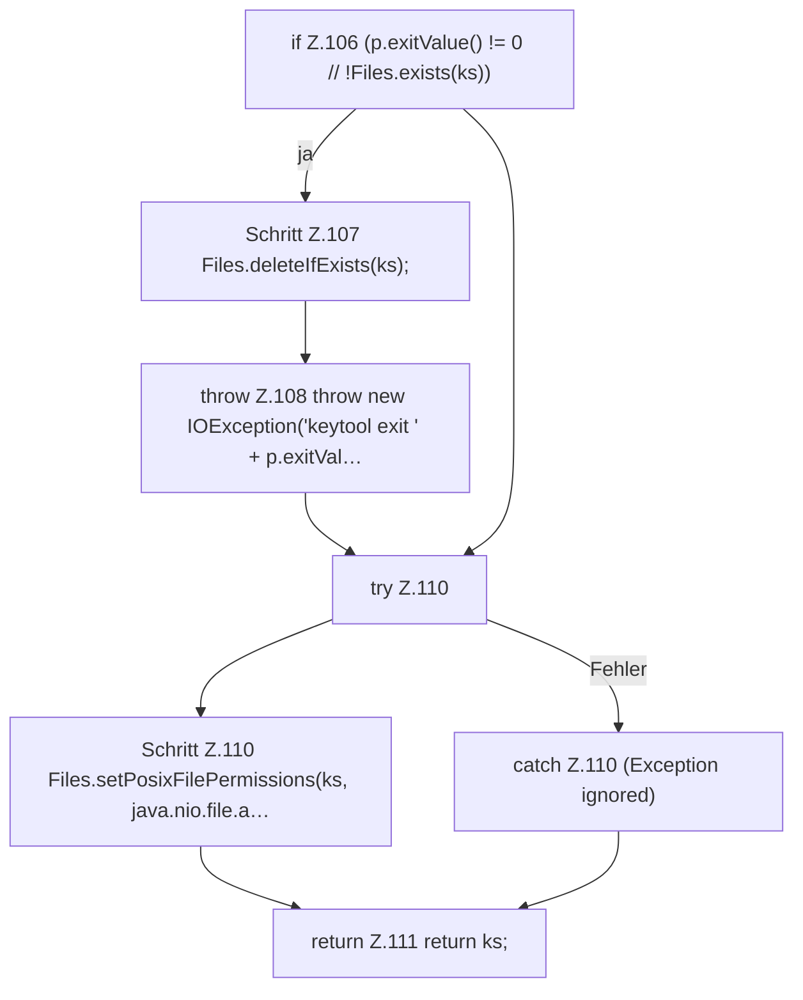

[[00 Start]] › [[Dashboard-HTTP]] › [[HTTP-Klassen]] › [[HttpsSupport]] › [[HttpsSupport.Teil1]] › [[HttpsSupport.ensureSelfSigned]] › [[HttpsSupport.ensureSelfSigned.Teil3]]

# HttpsSupport.ensureSelfSigned.Teil3

- Fortsetzung von `HttpsSupport.ensureSelfSigned`, Quellreihenfolge.
