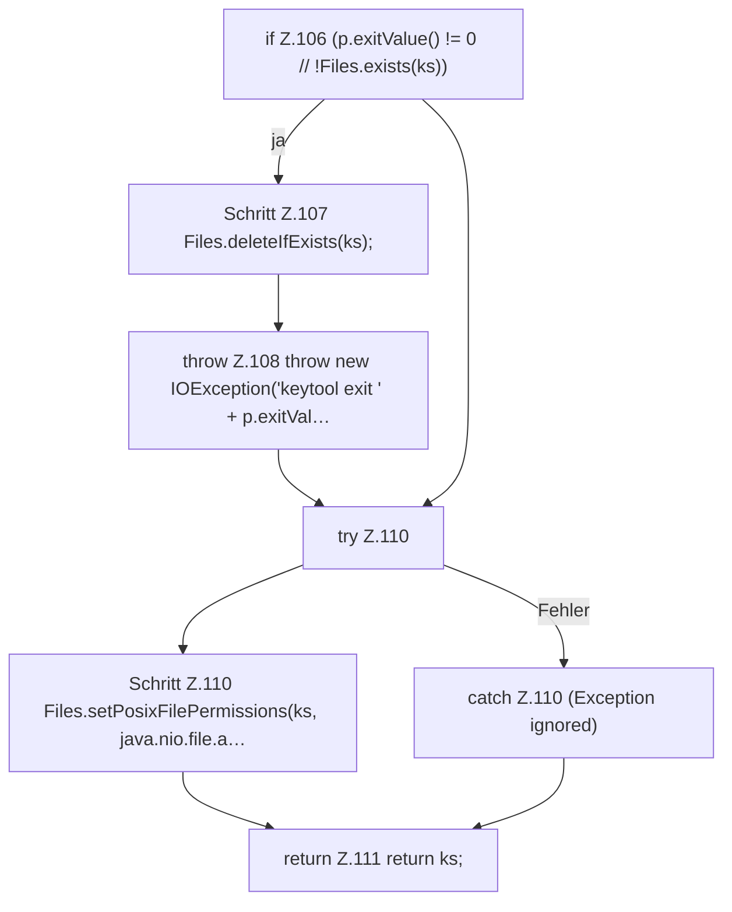

[[00 Start]] › [[Dashboard-HTTP]] › [[HTTP-Klassen]] › [[HttpsSupport]] › [[HttpsSupport.Teil1]] › [[HttpsSupport.ensureSelfSigned]] › [[HttpsSupport.ensureSelfSigned.Teil3]]

# HttpsSupport.ensureSelfSigned.Teil3



```knoten
if Z.106 (p.exitValue() != 0 // !Files.exists(ks))
  Zeile 106: prüft `(p.exitValue() != 0 // !Files.exists(ks))`.
Schritt Z.107 Files.deleteIfExists(ks);
  Zeile 107: Dateioperation. `Files.deleteIfExists(ks);`
throw Z.108 throw new IOException('keytool exit ' + p.exitVal…
  Zeile 108: Abbruch `throw new IOException('keytool exit ' + p.exitVal…`.
try Z.110
  Zeile 110: Versuch. Der Fehlerpfad geht in catch.
Schritt Z.110 Files.setPosixFilePermissions(ks, java.nio.file.a…
  Zeile 110: setzt POSIX-Dateirechte. `Files.setPosixFilePermissions(ks, java.nio.file.a…`
catch Z.110 (Exception ignored)
  Zeile 110: fängt (Exception ignored).
return Z.111 return ks;
  Zeile 111: Rückgabe `return ks;`.
```

> [!knoten]- Was die Blöcke tun
> - **if Z.106 (p.exitValue() != 0 // !Files.exists(ks))**: Zeile 106: prüft `(p.exitValue() != 0 // !Files.exists(ks))`.
> - **Schritt Z.107 Files.deleteIfExists(ks);**: Zeile 107: Dateioperation. `Files.deleteIfExists(ks);`
> - **throw Z.108 throw new IOException('keytool exit ' + p.exitVal…**: Zeile 108: Abbruch `throw new IOException('keytool exit ' + p.exitVal…`.
> - **try Z.110**: Zeile 110: Versuch. Der Fehlerpfad geht in catch.
> - **Schritt Z.110 Files.setPosixFilePermissions(ks, java.nio.file.a…**: Zeile 110: setzt POSIX-Dateirechte. `Files.setPosixFilePermissions(ks, java.nio.file.a…`
> - **catch Z.110 (Exception ignored)**: Zeile 110: fängt (Exception ignored).
> - **return Z.111 return ks;**: Zeile 111: Rückgabe `return ks;`.

- Ein weiterer Abschnitt derselben Übersicht.
- Fortsetzung von `HttpsSupport.ensureSelfSigned`.
