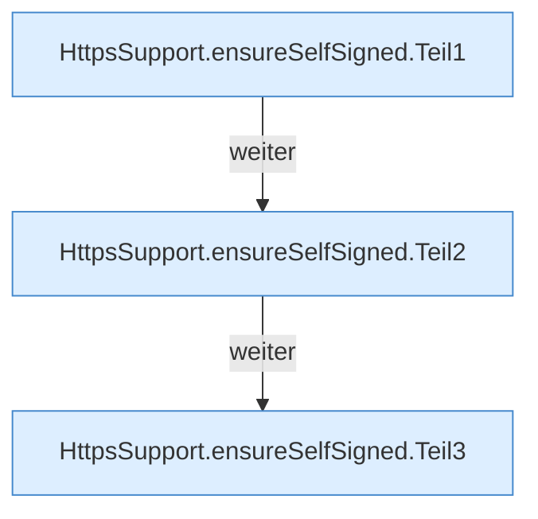

[[00 Start]] › [[Dashboard-HTTP]] › [[HTTP-Klassen]] › [[HttpsSupport]] › [[HttpsSupport.Teil1]] › [[HttpsSupport.ensureSelfSigned]]

# HttpsSupport.ensureSelfSigned

`HttpsSupport.ensureSelfSigned(Path dataDir, Spec spec, Consumer<String> log)` [src/main/java/de/aichele/childlauncher/HttpsSupport.java:86–112](https://github.com/Sciddie/minecraft-serverhoster-plugin/blob/95b02b953b0b4c23673e900e021a7c3c844aa37d/src/main/java/de/aichele/childlauncher/HttpsSupport.java#L86-L112)

- `ensureSelfSigned` in `src/main/java/de/aichele/childlauncher/HttpsSupport.java`
