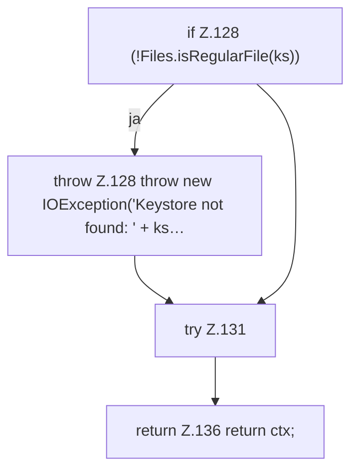

[[00 Start]] › [[Dashboard-HTTP]] › [[HTTP-Klassen]] › [[HttpsSupport]] › [[HttpsSupport.Teil1]] › [[HttpsSupport.fromKeystore]]

# HttpsSupport.fromKeystore

`HttpsSupport.fromKeystore(Path ks, char[][] pw)` [src/main/java/de/aichele/childlauncher/HttpsSupport.java:127–137](https://github.com/Sciddie/minecraft-serverhoster-plugin/blob/95b02b953b0b4c23673e900e021a7c3c844aa37d/src/main/java/de/aichele/childlauncher/HttpsSupport.java#L127-L137)



```knoten
if Z.128 (!Files.isRegularFile(ks))
  Zeile 128: prüft `(!Files.isRegularFile(ks))`.
throw Z.128 throw new IOException('Keystore not found: ' + ks…
  Zeile 128: Abbruch `throw new IOException('Keystore not found: ' + ks…`.
try Z.131
  Zeile 131: Versuch. Der Fehlerpfad geht in catch.
return Z.136 return ctx;
  Zeile 136: Rückgabe `return ctx;`.
```

- `fromKeystore` in `src/main/java/de/aichele/childlauncher/HttpsSupport.java`
