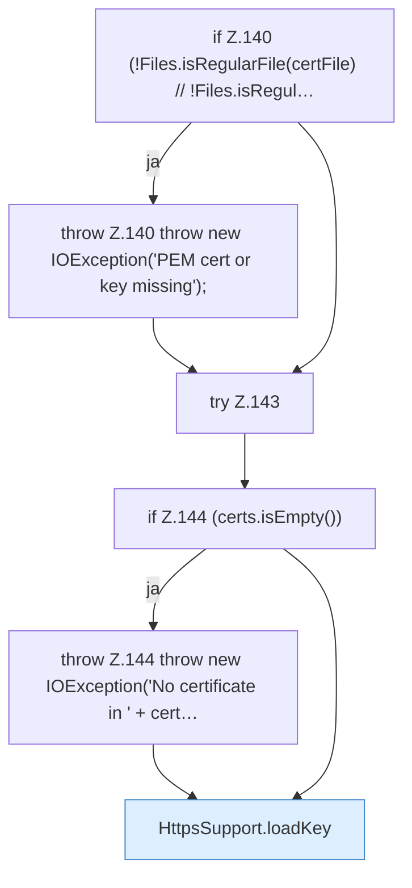

[[00 Start]] › [[Dashboard-HTTP]] › [[HTTP-Klassen]] › [[HttpsSupport]] › [[HttpsSupport.Teil2]] › [[HttpsSupport.fromPem]] › [[HttpsSupport.fromPem.Teil1]]

# HttpsSupport.fromPem.Teil1



```knoten
if Z.140 (!Files.isRegularFile(certFile) // !Files.isRegul…
  Zeile 140: prüft `(!Files.isRegularFile(certFile) // !Files.isRegul…`.
throw Z.140 throw new IOException('PEM cert or key missing');
  Zeile 140: Abbruch `throw new IOException('PEM cert or key missing');`.
try Z.143
  Zeile 143: Versuch. Der Fehlerpfad geht in catch.
if Z.144 (certs.isEmpty())
  Zeile 144: prüft `(certs.isEmpty())`.
throw Z.144 throw new IOException('No certificate in ' + cert…
  Zeile 144: Abbruch `throw new IOException('No certificate in ' + cert…`.
HttpsSupport.loadKey
  Dieser Teil lädt hier einen Schritt. Eine Ebene tiefer steht er genauer. Lädt `loadKey`. Ruft `pemBlock`, `wrapPkcs1`.
```

> [!knoten]- Was die Blöcke tun
> - **if Z.140 (!Files.isRegularFile(certFile) // !Files.isRegul…**: Zeile 140: prüft `(!Files.isRegularFile(certFile) // !Files.isRegul…`.
> - **throw Z.140 throw new IOException('PEM cert or key missing');**: Zeile 140: Abbruch `throw new IOException('PEM cert or key missing');`.
> - **try Z.143**: Zeile 143: Versuch. Der Fehlerpfad geht in catch.
> - **if Z.144 (certs.isEmpty())**: Zeile 144: prüft `(certs.isEmpty())`.
> - **throw Z.144 throw new IOException('No certificate in ' + cert…**: Zeile 144: Abbruch `throw new IOException('No certificate in ' + cert…`.
> - **HttpsSupport.loadKey**: Dieser Teil lädt hier einen Schritt. Eine Ebene tiefer steht er genauer. Lädt `loadKey`. Ruft `pemBlock`, `wrapPkcs1`.

- Ein weiterer Abschnitt derselben Übersicht.
- Fortsetzung von `HttpsSupport.fromPem`.
