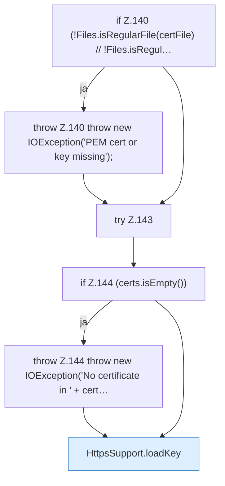

[[00 Start]] › [[Dashboard-HTTP]] › [[HTTP-Klassen]] › [[HttpsSupport]] › [[HttpsSupport.Teil2]] › [[HttpsSupport.fromPem]] › [[HttpsSupport.fromPem.Teil1]]

# HttpsSupport.fromPem.Teil1

- Fortsetzung von `HttpsSupport.fromPem`, Quellreihenfolge.
