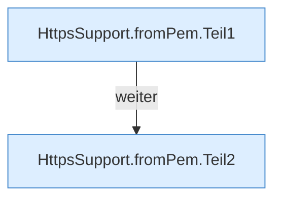

[[00 Start]] › [[Dashboard-HTTP]] › [[HTTP-Klassen]] › [[HttpsSupport]] › [[HttpsSupport.Teil2]] › [[HttpsSupport.fromPem]]

# HttpsSupport.fromPem

`HttpsSupport.fromPem(Path certFile, Path keyFile, char[] keyPass)` [src/main/java/de/aichele/childlauncher/HttpsSupport.java:139–154](https://github.com/Sciddie/minecraft-serverhoster-plugin/blob/95b02b953b0b4c23673e900e021a7c3c844aa37d/src/main/java/de/aichele/childlauncher/HttpsSupport.java#L139-L154)



```knoten
HttpsSupport.fromPem.Teil1
  Abschnitt 1 dieses Ablaufs, in Quellreihenfolge.
HttpsSupport.fromPem.Teil2
  Abschnitt 2 dieses Ablaufs, in Quellreihenfolge.
```

- `fromPem` in `src/main/java/de/aichele/childlauncher/HttpsSupport.java`
