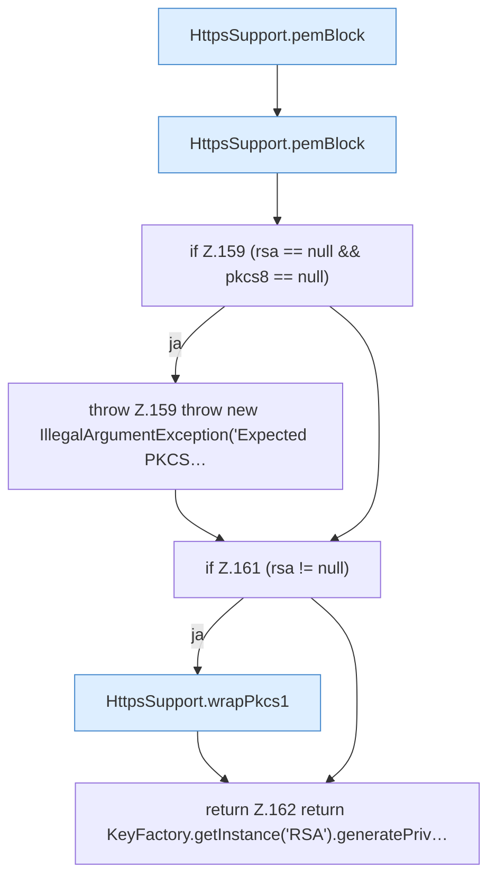

[[00 Start]] › [[Dashboard-HTTP]] › [[HTTP-Klassen]] › [[HttpsSupport]] › [[HttpsSupport.Teil2]] › [[HttpsSupport.loadKey]]

# HttpsSupport.loadKey

`HttpsSupport.loadKey(String pem)` [src/main/java/de/aichele/childlauncher/HttpsSupport.java:156–163](https://github.com/Sciddie/minecraft-serverhoster-plugin/blob/95b02b953b0b4c23673e900e021a7c3c844aa37d/src/main/java/de/aichele/childlauncher/HttpsSupport.java#L156-L163)

- `loadKey` in `src/main/java/de/aichele/childlauncher/HttpsSupport.java`
