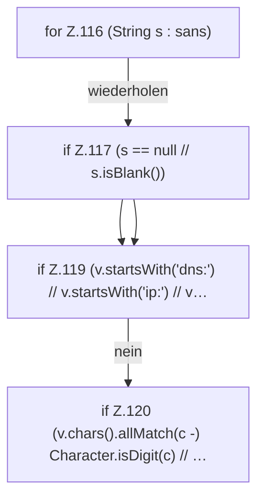

[[00 Start]] › [[Dashboard-HTTP]] › [[HTTP-Klassen]] › [[HttpsSupport]] › [[HttpsSupport.Teil1]] › [[HttpsSupport.normalizeSans]] › [[HttpsSupport.normalizeSans.Z116.Z116]]

# HttpsSupport.normalizeSans.Z116.Z116



```knoten
for Z.116 (String s : sans)
  Zeile 116: Schleife `(String s : sans)`.
if Z.117 (s == null // s.isBlank())
  Zeile 117: prüft `(s == null // s.isBlank())`.
if Z.119 (v.startsWith('dns:') // v.startsWith('ip:') // v…
  Zeile 119: prüft `(v.startsWith('dns:') // v.startsWith('ip:') // v…`.
if Z.120 (v.chars().allMatch(c -) Character.isDigit(c) // …
  Zeile 120: prüft `(v.chars().allMatch(c -) Character.isDigit(c) // …`.
```

> [!knoten]- Was die Blöcke tun
> - **for Z.116 (String s : sans)**: Zeile 116: Schleife `(String s : sans)`.
> - **if Z.117 (s == null // s.isBlank())**: Zeile 117: prüft `(s == null // s.isBlank())`.
> - **if Z.119 (v.startsWith('dns:') // v.startsWith('ip:') // v…**: Zeile 119: prüft `(v.startsWith('dns:') // v.startsWith('ip:') // v…`.
> - **if Z.120 (v.chars().allMatch(c -) Character.isDigit(c) // …**: Zeile 120: prüft `(v.chars().allMatch(c -) Character.isDigit(c) // …`.

- Der Ablauf geht in [[Glossar#Zeile|Zeile]] 116 weiter. Eine Ebene tiefer steht er genauer.
- Fortsetzung von `HttpsSupport.normalizeSans.Z116`.
