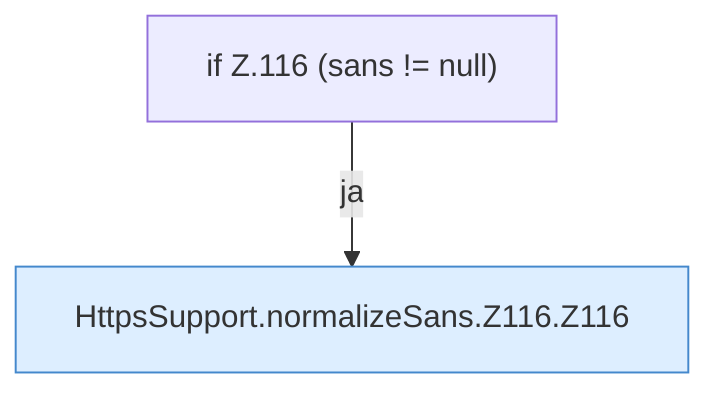

[[00 Start]] › [[Dashboard-HTTP]] › [[HTTP-Klassen]] › [[HttpsSupport]] › [[HttpsSupport.Teil1]] › [[HttpsSupport.normalizeSans]] › [[HttpsSupport.normalizeSans.Z116]]

# HttpsSupport.normalizeSans.Z116

- Fortsetzung von `HttpsSupport.normalizeSans`, Quellreihenfolge.
