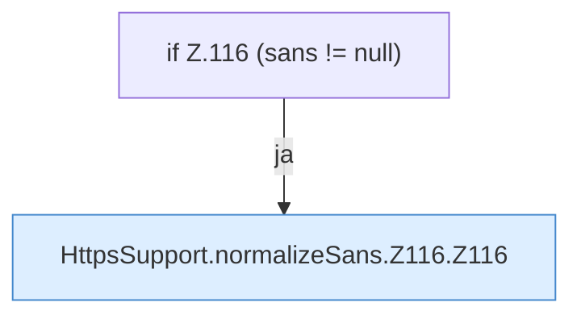

[[00 Start]] › [[Dashboard-HTTP]] › [[HTTP-Klassen]] › [[HttpsSupport]] › [[HttpsSupport.Teil1]] › [[HttpsSupport.normalizeSans]] › [[HttpsSupport.normalizeSans.Z116]]

# HttpsSupport.normalizeSans.Z116



```knoten
if Z.116 (sans != null)
  Zeile 116: prüft `(sans != null)`.
HttpsSupport.normalizeSans.Z116.Z116
  Der Ablauf geht in [[Glossar#Zeile|Zeile]] 116 weiter. Eine Ebene tiefer steht er genauer. Fortsetzung des Ablaufs ab Zeile 116.
```

> [!knoten]- Was die Blöcke tun
> - **if Z.116 (sans != null)**: Zeile 116: prüft `(sans != null)`.
> - **HttpsSupport.normalizeSans.Z116.Z116**: Der Ablauf geht in [[Glossar#Zeile|Zeile]] 116 weiter. Eine Ebene tiefer steht er genauer. Fortsetzung des Ablaufs ab Zeile 116.

- Der Ablauf geht in [[Glossar#Zeile|Zeile]] 116 weiter. Eine Ebene tiefer steht er genauer.
- Fortsetzung von `HttpsSupport.normalizeSans`.
