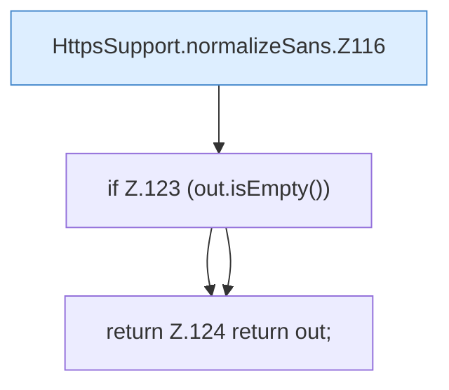

[[00 Start]] › [[Dashboard-HTTP]] › [[HTTP-Klassen]] › [[HttpsSupport]] › [[HttpsSupport.Teil1]] › [[HttpsSupport.normalizeSans]]

# HttpsSupport.normalizeSans

`HttpsSupport.normalizeSans(List<String> sans)` [src/main/java/de/aichele/childlauncher/HttpsSupport.java:114–125](https://github.com/Sciddie/minecraft-serverhoster-plugin/blob/95b02b953b0b4c23673e900e021a7c3c844aa37d/src/main/java/de/aichele/childlauncher/HttpsSupport.java#L114-L125)



```knoten
HttpsSupport.normalizeSans.Z116
  Fortsetzung des Ablaufs ab Zeile 116.
if Z.123 (out.isEmpty())
  Zeile 123: prüft `(out.isEmpty())`.
return Z.124 return out;
  Zeile 124: Rückgabe `return out;`.
```

- `normalizeSans` in `src/main/java/de/aichele/childlauncher/HttpsSupport.java`
