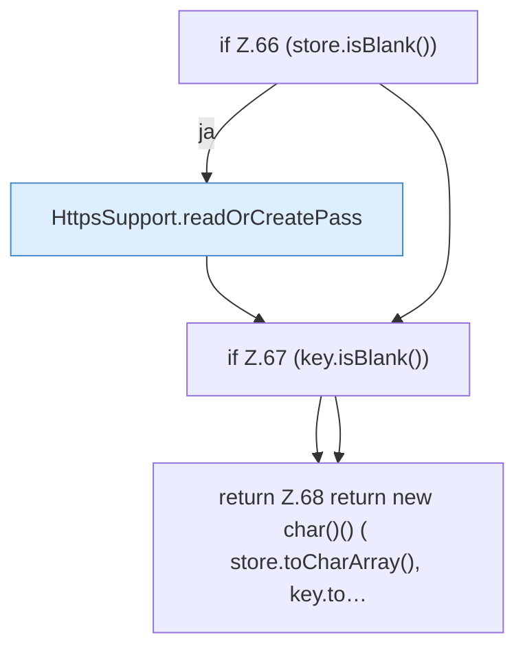

[[00 Start]] › [[Dashboard-HTTP]] › [[HTTP-Klassen]] › [[HttpsSupport]] › [[HttpsSupport.Teil1]] › [[HttpsSupport.password]]

# HttpsSupport.password

`HttpsSupport.password(Path dataDir, Spec spec)` [src/main/java/de/aichele/childlauncher/HttpsSupport.java:63–69](https://github.com/Sciddie/minecraft-serverhoster-plugin/blob/95b02b953b0b4c23673e900e021a7c3c844aa37d/src/main/java/de/aichele/childlauncher/HttpsSupport.java#L63-L69)

- `password` in `src/main/java/de/aichele/childlauncher/HttpsSupport.java`
