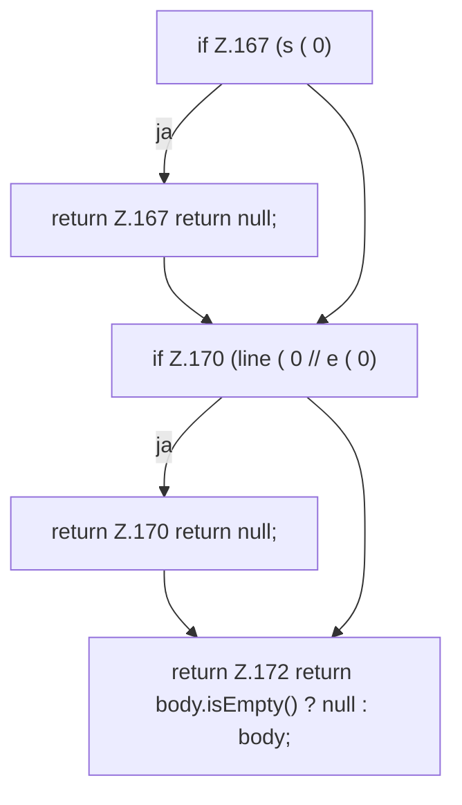

[[00 Start]] › [[Dashboard-HTTP]] › [[HTTP-Klassen]] › [[HttpsSupport]] › [[HttpsSupport.Teil2]] › [[HttpsSupport.pemBlock]]

# HttpsSupport.pemBlock

`HttpsSupport.pemBlock(String pem, String marker)` [src/main/java/de/aichele/childlauncher/HttpsSupport.java:165–173](https://github.com/Sciddie/minecraft-serverhoster-plugin/blob/95b02b953b0b4c23673e900e021a7c3c844aa37d/src/main/java/de/aichele/childlauncher/HttpsSupport.java#L165-L173)



```knoten
if Z.167 (s ( 0)
  Zeile 167: prüft `(s ( 0)`.
return Z.167 return null;
  Zeile 167: Rückgabe `return null;`.
if Z.170 (line ( 0 // e ( 0)
  Zeile 170: prüft `(line ( 0 // e ( 0)`.
return Z.170 return null;
  Zeile 170: Rückgabe `return null;`.
return Z.172 return body.isEmpty() ? null : body;
  Zeile 172: Rückgabe `return body.isEmpty() ? null : body;`.
```

> [!knoten]- Was die Blöcke tun
> - **if Z.167 (s ( 0)**: Zeile 167: prüft `(s ( 0)`.
> - **return Z.167 return null;**: Zeile 167: Rückgabe `return null;`.
> - **if Z.170 (line ( 0 // e ( 0)**: Zeile 170: prüft `(line ( 0 // e ( 0)`.
> - **return Z.170 return null;**: Zeile 170: Rückgabe `return null;`.
> - **return Z.172 return body.isEmpty() ? null : body;**: Zeile 172: Rückgabe `return body.isEmpty() ? null : body;`.

- Dieser Teil macht hier einen einzelnen Schritt. Eine Ebene tiefer steht er genauer.
- `pemBlock` in `src/main/java/de/aichele/childlauncher/HttpsSupport.java`
