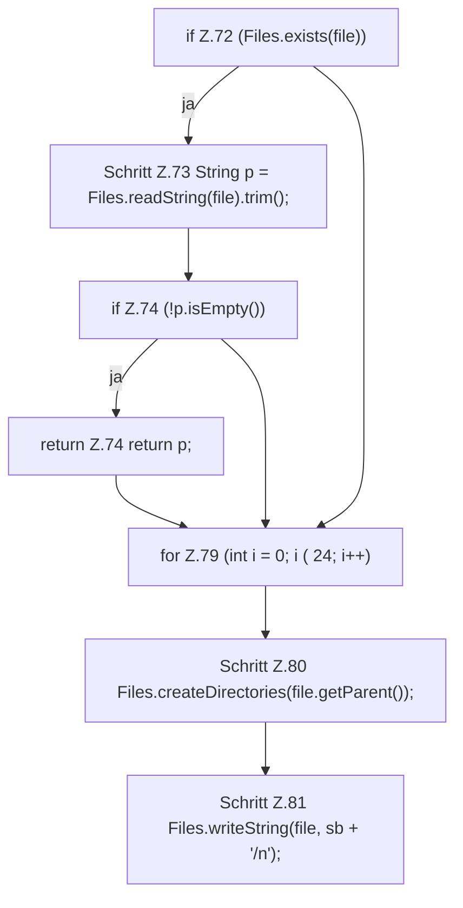

[[00 Start]] › [[Dashboard-HTTP]] › [[HTTP-Klassen]] › [[HttpsSupport]] › [[HttpsSupport.Teil1]] › [[HttpsSupport.readOrCreatePass]] › [[HttpsSupport.readOrCreatePass.Teil1]]

# HttpsSupport.readOrCreatePass.Teil1



```knoten
if Z.72 (Files.exists(file))
  Zeile 72: prüft `(Files.exists(file))`.
Schritt Z.73 String p = Files.readString(file).trim();
  Zeile 73: liest Text aus einer Datei. `String p = Files.readString(file).trim();`
if Z.74 (!p.isEmpty())
  Zeile 74: prüft `(!p.isEmpty())`.
return Z.74 return p;
  Zeile 74: Rückgabe `return p;`.
for Z.79 (int i = 0; i ( 24; i++)
  Zeile 79: Schleife `(int i = 0; i ( 24; i++)`.
Schritt Z.80 Files.createDirectories(file.getParent());
  Zeile 80: Dateioperation. `Files.createDirectories(file.getParent());`
Schritt Z.81 Files.writeString(file, sb + '/n');
  Zeile 81: schreibt Text in eine Datei. `Files.writeString(file, sb + '/n');`
```

- Fortsetzung von `HttpsSupport.readOrCreatePass`, Quellreihenfolge.
