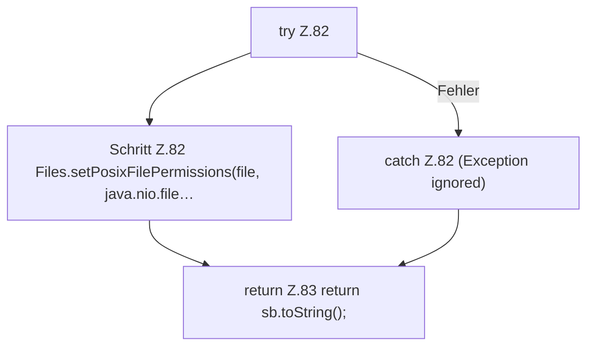

[[00 Start]] › [[Dashboard-HTTP]] › [[HTTP-Klassen]] › [[HttpsSupport]] › [[HttpsSupport.Teil1]] › [[HttpsSupport.readOrCreatePass]] › [[HttpsSupport.readOrCreatePass.Teil2]]

# HttpsSupport.readOrCreatePass.Teil2



```knoten
try Z.82
  Zeile 82: Versuch. Der Fehlerpfad geht in catch.
Schritt Z.82 Files.setPosixFilePermissions(file, java.nio.file…
  Zeile 82: setzt POSIX-Dateirechte. `Files.setPosixFilePermissions(file, java.nio.file…`
catch Z.82 (Exception ignored)
  Zeile 82: fängt (Exception ignored).
return Z.83 return sb.toString();
  Zeile 83: Rückgabe `return sb.toString();`.
```

- Fortsetzung von `HttpsSupport.readOrCreatePass`, Quellreihenfolge.
