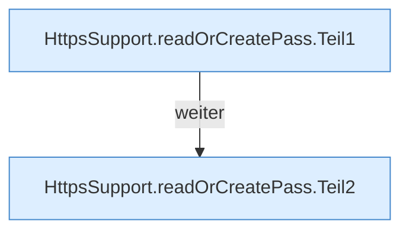

[[00 Start]] › [[Dashboard-HTTP]] › [[HTTP-Klassen]] › [[HttpsSupport]] › [[HttpsSupport.Teil1]] › [[HttpsSupport.readOrCreatePass]]

# HttpsSupport.readOrCreatePass

`HttpsSupport.readOrCreatePass(Path file)` [src/main/java/de/aichele/childlauncher/HttpsSupport.java:71–84](https://github.com/Sciddie/minecraft-serverhoster-plugin/blob/95b02b953b0b4c23673e900e021a7c3c844aa37d/src/main/java/de/aichele/childlauncher/HttpsSupport.java#L71-L84)



```knoten
HttpsSupport.readOrCreatePass.Teil1
  Ein weiterer Abschnitt derselben Übersicht. Abschnitt 1 dieses Ablaufs, in Quellreihenfolge.
HttpsSupport.readOrCreatePass.Teil2
  Ein weiterer Abschnitt derselben Übersicht. Abschnitt 2 dieses Ablaufs, in Quellreihenfolge.
```

> [!knoten]- Was die Blöcke tun
> - **HttpsSupport.readOrCreatePass.Teil1**: Ein weiterer Abschnitt derselben Übersicht. Abschnitt 1 dieses Ablaufs, in Quellreihenfolge.
> - **HttpsSupport.readOrCreatePass.Teil2**: Ein weiterer Abschnitt derselben Übersicht. Abschnitt 2 dieses Ablaufs, in Quellreihenfolge.

- Dieser Teil liest oder den Ersatz.
- `readOrCreatePass` in `src/main/java/de/aichele/childlauncher/HttpsSupport.java`
