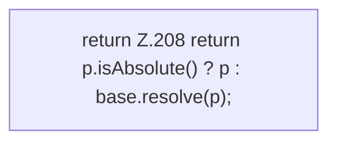

[[00 Start]] › [[Dashboard-HTTP]] › [[HTTP-Klassen]] › [[HttpsSupport]] › [[HttpsSupport.Teil2]] › [[HttpsSupport.resolve]]

# HttpsSupport.resolve

`HttpsSupport.resolve(Path base, String configured, String fallback)` [src/main/java/de/aichele/childlauncher/HttpsSupport.java:205–209](https://github.com/Sciddie/minecraft-serverhoster-plugin/blob/95b02b953b0b4c23673e900e021a7c3c844aa37d/src/main/java/de/aichele/childlauncher/HttpsSupport.java#L205-L209)



```knoten
return Z.208 return p.isAbsolute() ? p : base.resolve(p);
  Zeile 208: Rückgabe `return p.isAbsolute() ? p : base.resolve(p);`.
```

> [!knoten]- Was die Blöcke tun
> - **return Z.208 return p.isAbsolute() ? p : base.resolve(p);**: Zeile 208: Rückgabe `return p.isAbsolute() ? p : base.resolve(p);`.

- Dieser Teil bestimmt das.
- `resolve` in `src/main/java/de/aichele/childlauncher/HttpsSupport.java`
