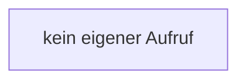

[[00 Start]] › [[Server-Anlage]] › [[Startplan]] › [[JarProbe]] › [[JarProbe.JarProbe]]

# JarProbe.JarProbe

`JarProbe.JarProbe()` [src/main/java/de/aichele/childlauncher/JarProbe.java:14–14](https://github.com/Sciddie/minecraft-serverhoster-plugin/blob/95b02b953b0b4c23673e900e021a7c3c844aa37d/src/main/java/de/aichele/childlauncher/JarProbe.java#L14-L14)



```knoten
kein eigener Aufruf
  In diesem Stück gibt es keinen weiteren eigenen Aufruf.
```

> [!knoten]- Was die Blöcke tun
> - **kein eigener Aufruf**: In diesem Stück gibt es keinen weiteren eigenen Aufruf.

- Dieser Teil kümmert sich um die Messung.
- `JarProbe` in `src/main/java/de/aichele/childlauncher/JarProbe.java`
