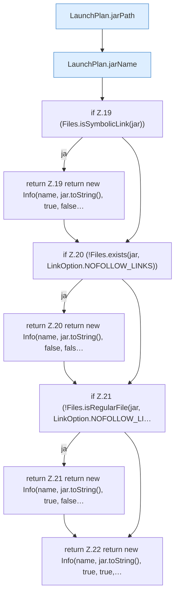

[[00 Start]] › [[Server-Anlage]] › [[Startplan]] › [[JarProbe]] › [[JarProbe.inspect]]

# JarProbe.inspect

`JarProbe.inspect(ServerProfile profile)` [src/main/java/de/aichele/childlauncher/JarProbe.java:16–23](https://github.com/Sciddie/minecraft-serverhoster-plugin/blob/95b02b953b0b4c23673e900e021a7c3c844aa37d/src/main/java/de/aichele/childlauncher/JarProbe.java#L16-L23)



```knoten
LaunchPlan.jarPath
  Betrifft das Jar `jarPath`. Ruft `directory`, `jarName`.
LaunchPlan.jarName
  Betrifft das Jar `jarName`. Ruft `fileName`.
if Z.19 (Files.isSymbolicLink(jar))
  Zeile 19: prüft `(Files.isSymbolicLink(jar))`.
return Z.19 return new Info(name, jar.toString(), true, false…
  Zeile 19: Rückgabe `return new Info(name, jar.toString(), true, false…`.
if Z.20 (!Files.exists(jar, LinkOption.NOFOLLOW_LINKS))
  Zeile 20: prüft `(!Files.exists(jar, LinkOption.NOFOLLOW_LINKS))`.
return Z.20 return new Info(name, jar.toString(), false, fals…
  Zeile 20: Rückgabe `return new Info(name, jar.toString(), false, fals…`.
if Z.21 (!Files.isRegularFile(jar, LinkOption.NOFOLLOW_LI…
  Zeile 21: prüft `(!Files.isRegularFile(jar, LinkOption.NOFOLLOW_LI…`.
return Z.21 return new Info(name, jar.toString(), true, false…
  Zeile 21: Rückgabe `return new Info(name, jar.toString(), true, false…`.
return Z.22 return new Info(name, jar.toString(), true, true,…
  Zeile 22: Rückgabe `return new Info(name, jar.toString(), true, true,…`.
```

- `inspect` in `src/main/java/de/aichele/childlauncher/JarProbe.java`
