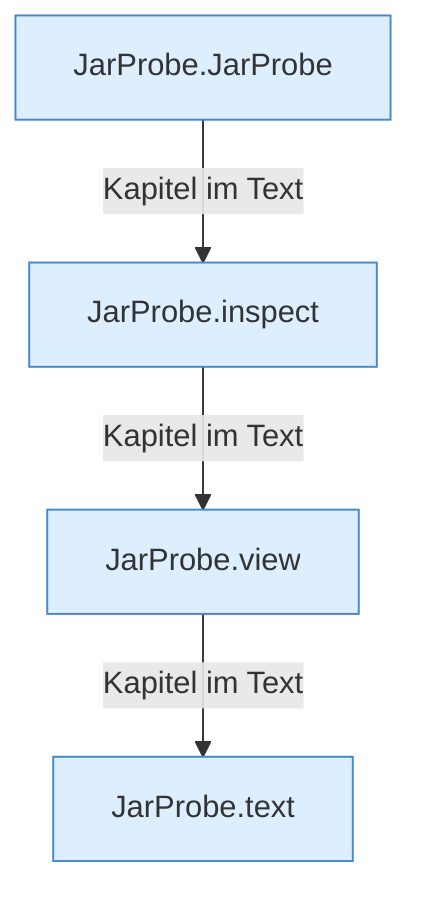

[[00 Start]] › [[Server-Anlage]] › [[Startplan]] › [[JarProbe]]

# JarProbe



```knoten
JarProbe.JarProbe
  Dieser Teil kümmert sich um die Messung. Im [[Glossar#Quelltext|Quelltext]] heißt das `JarProbe`.
JarProbe.inspect
  Dieser Teil macht hier einen einzelnen Schritt. Eine Ebene tiefer steht er genauer. Im [[Glossar#Quelltext|Quelltext]] heißt das `inspect`.
JarProbe.view
  Dieser Teil macht hier einen einzelnen Schritt. Eine Ebene tiefer steht er genauer. Im [[Glossar#Quelltext|Quelltext]] heißt das `view`.
JarProbe.text
  Dieser Teil macht hier einen einzelnen Schritt. Eine Ebene tiefer steht er genauer. Im [[Glossar#Quelltext|Quelltext]] heißt das `text`.
```

> [!knoten]- Was die Blöcke tun
> - **JarProbe.JarProbe**: Dieser Teil kümmert sich um die Messung. Im [[Glossar#Quelltext|Quelltext]] heißt das `JarProbe`.
> - **JarProbe.inspect**: Dieser Teil macht hier einen einzelnen Schritt. Eine Ebene tiefer steht er genauer. Im [[Glossar#Quelltext|Quelltext]] heißt das `inspect`.
> - **JarProbe.view**: Dieser Teil macht hier einen einzelnen Schritt. Eine Ebene tiefer steht er genauer. Im [[Glossar#Quelltext|Quelltext]] heißt das `view`.
> - **JarProbe.text**: Dieser Teil macht hier einen einzelnen Schritt. Eine Ebene tiefer steht er genauer. Im [[Glossar#Quelltext|Quelltext]] heißt das `text`.

- Sieht in die [[Glossar#Programmdatei|Programmdatei]] und liest ab, was für ein Server darin steckt.
