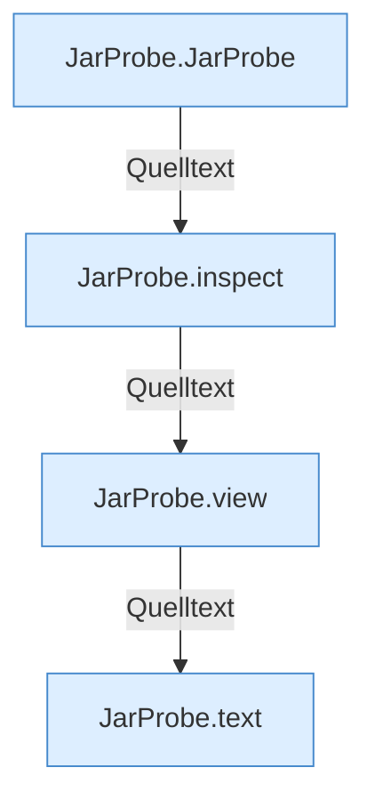

[[00 Start]] › [[Server-Anlage]] › [[Startplan]] › [[JarProbe]]

# JarProbe



```knoten
JarProbe.JarProbe
  Betrifft das Jar `JarProbe`.
JarProbe.inspect
  `inspect` in `JarProbe.java`. Ruft `jarPath`, `jarName`.
JarProbe.view
  Liefert die Sicht `view`.
JarProbe.text
  Antwortet mit Text `text`.
```


