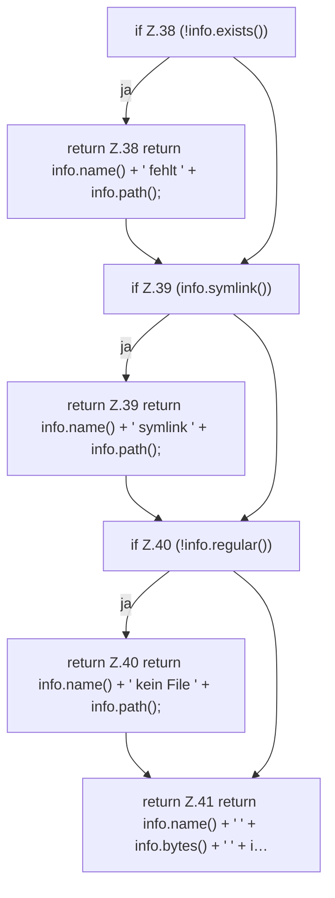

[[00 Start]] › [[Server-Anlage]] › [[Startplan]] › [[JarProbe]] › [[JarProbe.text]]

# JarProbe.text

`JarProbe.text(Info info)` [src/main/java/de/aichele/childlauncher/JarProbe.java:37–42](https://github.com/Sciddie/minecraft-serverhoster-plugin/blob/95b02b953b0b4c23673e900e021a7c3c844aa37d/src/main/java/de/aichele/childlauncher/JarProbe.java#L37-L42)



```knoten
if Z.38 (!info.exists())
  Zeile 38: prüft `(!info.exists())`.
return Z.38 return info.name() + ' fehlt ' + info.path();
  Zeile 38: Rückgabe `return info.name() + ' fehlt ' + info.path();`.
if Z.39 (info.symlink())
  Zeile 39: prüft `(info.symlink())`.
return Z.39 return info.name() + ' symlink ' + info.path();
  Zeile 39: Rückgabe `return info.name() + ' symlink ' + info.path();`.
if Z.40 (!info.regular())
  Zeile 40: prüft `(!info.regular())`.
return Z.40 return info.name() + ' kein File ' + info.path();
  Zeile 40: Rückgabe `return info.name() + ' kein File ' + info.path();`.
return Z.41 return info.name() + ' ' + info.bytes() + ' ' + i…
  Zeile 41: Rückgabe `return info.name() + ' ' + info.bytes() + ' ' + i…`.
```

> [!knoten]- Was die Blöcke tun
> - **if Z.38 (!info.exists())**: Zeile 38: prüft `(!info.exists())`.
> - **return Z.38 return info.name() + ' fehlt ' + info.path();**: Zeile 38: Rückgabe `return info.name() + ' fehlt ' + info.path();`.
> - **if Z.39 (info.symlink())**: Zeile 39: prüft `(info.symlink())`.
> - **return Z.39 return info.name() + ' symlink ' + info.path();**: Zeile 39: Rückgabe `return info.name() + ' symlink ' + info.path();`.
> - **if Z.40 (!info.regular())**: Zeile 40: prüft `(!info.regular())`.
> - **return Z.40 return info.name() + ' kein File ' + info.path();**: Zeile 40: Rückgabe `return info.name() + ' kein File ' + info.path();`.
> - **return Z.41 return info.name() + ' ' + info.bytes() + ' ' + i…**: Zeile 41: Rückgabe `return info.name() + ' ' + info.bytes() + ' ' + i…`.

- Dieser Teil macht hier einen einzelnen Schritt. Eine Ebene tiefer steht er genauer.
- `text` in `src/main/java/de/aichele/childlauncher/JarProbe.java`
