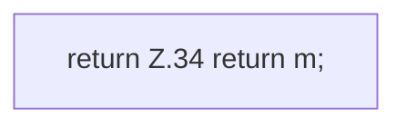

[[00 Start]] › [[Server-Anlage]] › [[Startplan]] › [[JarProbe]] › [[JarProbe.view]]

# JarProbe.view

`JarProbe.view(Info info)` [src/main/java/de/aichele/childlauncher/JarProbe.java:25–35](https://github.com/Sciddie/minecraft-serverhoster-plugin/blob/95b02b953b0b4c23673e900e021a7c3c844aa37d/src/main/java/de/aichele/childlauncher/JarProbe.java#L25-L35)



```knoten
return Z.34 return m;
  Zeile 34: Rückgabe `return m;`.
```

- `view` in `src/main/java/de/aichele/childlauncher/JarProbe.java`
