[[00 Start]] › [[Plugin-Kern]] › [[Konfiguration]]

# Konfiguration

```mermaid
flowchart TD
  n1["ServerHosterSettings"]:::internal-link
  n2["FabricLauncherPlugin.settingsView"]:::internal-link
  n3["FabricLauncherPlugin.saveSettings"]:::internal-link
  n4["FabricLauncherPlugin.configMutationLock"]:::internal-link
  n5["FabricLauncherPlugin.reloadProfiles"]:::internal-link
  classDef internal-link fill:#ddeeff,stroke:#4488cc
  classDef befund fill:#f88
  style n5 fill:#f88,stroke:#900
```



```knoten
ServerHosterSettings
  Prüft die [[Glossar#Einstellungen|Einstellungen]], bevor sie benutzt werden, zum Beispiel [[Glossar#Pause|Pausen]] und die Angaben für eine Sicherung über das Netz.
FabricLauncherPlugin.settingsView
  Stellt die [[Glossar#Einstellungen|Einstellungen]] so zusammen, wie die [[Glossar#Bedienseite|Bedienseite]] sie anzeigt.
FabricLauncherPlugin.saveSettings
  Das [[Glossar#Plugin|Plugin]] speichert die [[Glossar#Einstellungen|Einstellungen]].
FabricLauncherPlugin.configMutationLock
  Sorgt dafür, dass nicht zwei Änderungen der [[Glossar#Einstellungen|Einstellungen]] gleichzeitig schreiben.
FabricLauncherPlugin.reloadProfiles
  Liest die Server aus den [[Glossar#Einstellungen|Einstellungen]] neu und behält nur den ersten. Auffällig: es ist vorgesehen, der laufende Weg benutzt es aber nicht. Das nennt man [[Glossar#Nicht benutzt|Nicht benutzt]].
```

> [!knoten] Was die Blöcke tun
> - **ServerHosterSettings**: Prüft die [[Glossar#Einstellungen|Einstellungen]], bevor sie benutzt werden, zum Beispiel [[Glossar#Pause|Pausen]] und die Angaben für eine Sicherung über das Netz.
> - **FabricLauncherPlugin.settingsView**: Stellt die [[Glossar#Einstellungen|Einstellungen]] so zusammen, wie die [[Glossar#Bedienseite|Bedienseite]] sie anzeigt.
> - **FabricLauncherPlugin.saveSettings**: Das [[Glossar#Plugin|Plugin]] speichert die [[Glossar#Einstellungen|Einstellungen]].
> - **FabricLauncherPlugin.configMutationLock**: Sorgt dafür, dass nicht zwei Änderungen der [[Glossar#Einstellungen|Einstellungen]] gleichzeitig schreiben.
> - **FabricLauncherPlugin.reloadProfiles**: Liest die Server aus den [[Glossar#Einstellungen|Einstellungen]] neu und behält nur den ersten. Auffällig: es ist vorgesehen, der laufende Weg benutzt es aber nicht. Das nennt man [[Glossar#Nicht benutzt|Nicht benutzt]].

- Lesen und Schreiben der [[Glossar#Einstellungen|Einstellungen]]. Stehen mehrere Server in der Datei, behält der laufende Weg nur den ersten.
