[[00 Start]] › [[Plugin-Kern]] › [[Konfiguration]]

# Konfiguration

```mermaid
flowchart TD
  n1["ServerHosterSettings"]:::internal-link
  n2["FabricLauncherPlugin.settingsView"]:::internal-link
  n3["FabricLauncherPlugin.saveSettings"]:::internal-link
  n4["FabricLauncherPlugin.configMutationLock"]:::internal-link
  n5["FabricLauncherPlugin.reloadProfiles"]:::internal-link
  classDef internal-link fill:#ddeeff,stroke:#4488cc
  classDef befund fill:#f88
  style n5 fill:#f88,stroke:#900
```



```knoten
ServerHosterSettings
  Geprüfte Sicht der Config, inklusive Restart- und FTP-Grenzen.
FabricLauncherPlugin.settingsView
  `settingsView` in `FabricLauncherPlugin.java`. Ruft `from`, `view`.
FabricLauncherPlugin.saveSettings
  Speichert `saveSettings`. Ruft `apply`, `saveConfigWritable`.
FabricLauncherPlugin.configMutationLock
  `configMutationLock` in `FabricLauncherPlugin.java`.
FabricLauncherPlugin.reloadProfiles
  `Profiles.load`, danach nur `getFirst()`. Befund: angemeldet aber nicht umgesetzt (sicher).
```

- `reloadProfiles` behält nur `configured.getFirst()`.
- Record `ServerHosterSettings` prüft Restart- und FTP-Grenzen.
