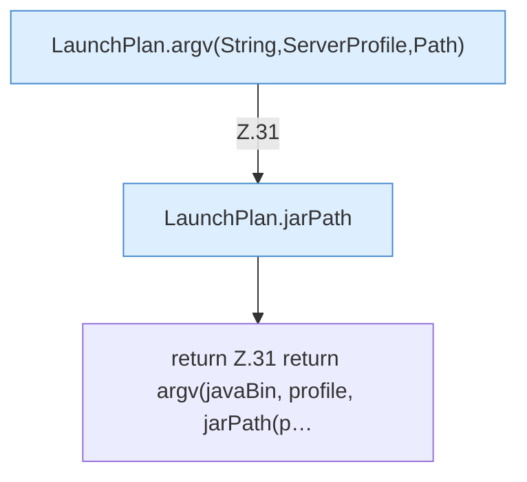

[[00 Start]] › [[Server-Anlage]] › [[Startplan]] › [[LaunchPlan]] › [[LaunchPlan.argv(String,ServerProfile)]]

# LaunchPlan.argv(String,ServerProfile)

`LaunchPlan.argv(String javaBin, ServerProfile profile)` [src/main/java/de/aichele/childlauncher/LaunchPlan.java:30–32](https://github.com/Sciddie/minecraft-serverhoster-plugin/blob/95b02b953b0b4c23673e900e021a7c3c844aa37d/src/main/java/de/aichele/childlauncher/LaunchPlan.java#L30-L32)



```knoten
LaunchPlan.argv(String,ServerProfile,Path)
  Dieser Teil macht hier einen einzelnen Schritt. Eine Ebene tiefer steht er genauer. `argv` in `LaunchPlan.java`.
LaunchPlan.jarPath
  Dieser Teil kümmert sich um den Pfad. Betrifft das Jar `jarPath`. Ruft `directory`, `jarName`.
return Z.31 return argv(javaBin, profile, jarPath(p…
  Zeile 31: Rückgabe `return argv(javaBin, profile, jarPath(p…`.
```

> [!knoten]- Was die Blöcke tun
> - **LaunchPlan.argv(String,ServerProfile,Path)**: Dieser Teil macht hier einen einzelnen Schritt. Eine Ebene tiefer steht er genauer. `argv` in `LaunchPlan.java`.
> - **LaunchPlan.jarPath**: Dieser Teil kümmert sich um den Pfad. Betrifft das Jar `jarPath`. Ruft `directory`, `jarName`.
> - **return Z.31 return argv(javaBin, profile, jarPath(p…**: Zeile 31: Rückgabe `return argv(javaBin, profile, jarPath(p…`.

- Dieser Teil macht hier einen einzelnen Schritt. Eine Ebene tiefer steht er genauer.
- `argv` in `src/main/java/de/aichele/childlauncher/LaunchPlan.java`
