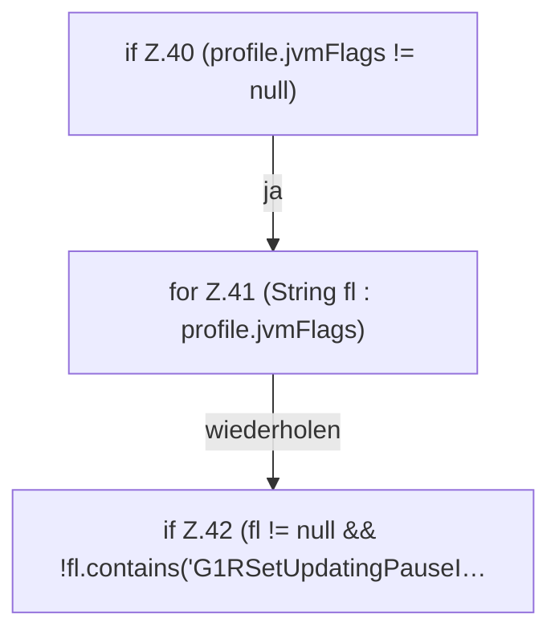

[[00 Start]] › [[Server-Anlage]] › [[Startplan]] › [[LaunchPlan]] › [[LaunchPlan.argv(String,ServerProfile,Path)]] › [[LaunchPlan.argv(String,ServerProfile,Path).Teil1]]

# LaunchPlan.argv(String,ServerProfile,Path).Teil1

- Fortsetzung von `LaunchPlan.argv(String,ServerProfile,Path)`, Quellreihenfolge.
