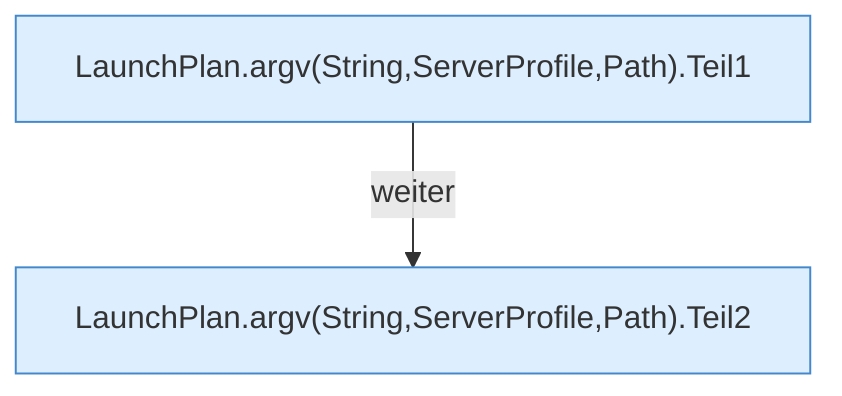

[[00 Start]] › [[Server-Anlage]] › [[Startplan]] › [[LaunchPlan]] › [[LaunchPlan.argv(String,ServerProfile,Path)]]

# LaunchPlan.argv(String,ServerProfile,Path)

`LaunchPlan.argv(String javaBin, ServerProfile profile, Path jar)` [src/main/java/de/aichele/childlauncher/LaunchPlan.java:34–50](https://github.com/Sciddie/minecraft-serverhoster-plugin/blob/95b02b953b0b4c23673e900e021a7c3c844aa37d/src/main/java/de/aichele/childlauncher/LaunchPlan.java#L34-L50)

- `argv` in `src/main/java/de/aichele/childlauncher/LaunchPlan.java`
