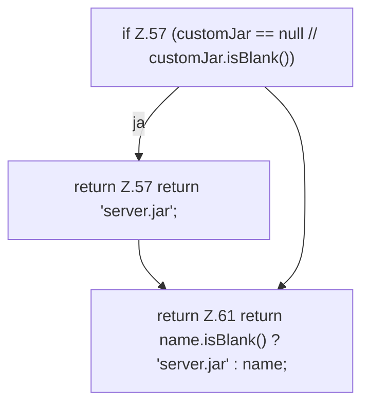

[[00 Start]] › [[Server-Anlage]] › [[Startplan]] › [[LaunchPlan]] › [[LaunchPlan.fileName]]

# LaunchPlan.fileName

`LaunchPlan.fileName(String customJar)` [src/main/java/de/aichele/childlauncher/LaunchPlan.java:56–62](https://github.com/Sciddie/minecraft-serverhoster-plugin/blob/95b02b953b0b4c23673e900e021a7c3c844aa37d/src/main/java/de/aichele/childlauncher/LaunchPlan.java#L56-L62)



```knoten
if Z.57 (customJar == null // customJar.isBlank())
  Zeile 57: prüft `(customJar == null // customJar.isBlank())`.
return Z.57 return 'server.jar';
  Zeile 57: Rückgabe `return 'server.jar';`.
return Z.61 return name.isBlank() ? 'server.jar' : name;
  Zeile 61: Rückgabe `return name.isBlank() ? 'server.jar' : name;`.
```

> [!knoten]- Was die Blöcke tun
> - **if Z.57 (customJar == null // customJar.isBlank())**: Zeile 57: prüft `(customJar == null // customJar.isBlank())`.
> - **return Z.57 return 'server.jar';**: Zeile 57: Rückgabe `return 'server.jar';`.
> - **return Z.61 return name.isBlank() ? 'server.jar' : name;**: Zeile 61: Rückgabe `return name.isBlank() ? 'server.jar' : name;`.

- Dieser Teil kümmert sich um den Namen.
- `fileName` in `src/main/java/de/aichele/childlauncher/LaunchPlan.java`
