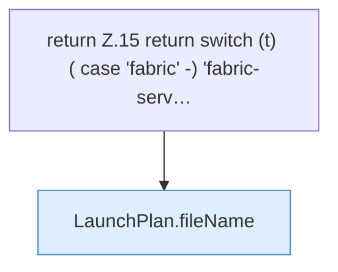

[[00 Start]] › [[Server-Anlage]] › [[Startplan]] › [[LaunchPlan]] › [[LaunchPlan.jarName]] › [[LaunchPlan.jarName.Z15]]

# LaunchPlan.jarName.Z15

- Fortsetzung von `LaunchPlan.jarName`, Quellreihenfolge.
