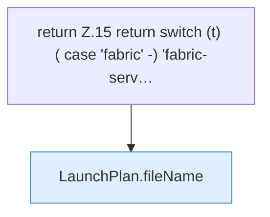

[[00 Start]] › [[Server-Anlage]] › [[Startplan]] › [[LaunchPlan]] › [[LaunchPlan.jarName]] › [[LaunchPlan.jarName.Z15]]

# LaunchPlan.jarName.Z15



```knoten
return Z.15 return switch (t) ( case 'fabric' -) 'fabric-serv…
  Zeile 15: Rückgabe `return switch (t) ( case 'fabric' -) 'fabric-serv…`.
LaunchPlan.fileName
  Dieser Teil kümmert sich um den Namen. Liefert die Datei `fileName`.
```

> [!knoten]- Was die Blöcke tun
> - **return Z.15 return switch (t) ( case 'fabric' -) 'fabric-serv…**: Zeile 15: Rückgabe `return switch (t) ( case 'fabric' -) 'fabric-serv…`.
> - **LaunchPlan.fileName**: Dieser Teil kümmert sich um den Namen. Liefert die Datei `fileName`.

- Der Ablauf geht in [[Glossar#Zeile|Zeile]] 15 weiter. Eine Ebene tiefer steht er genauer.
- Fortsetzung von `LaunchPlan.jarName`.
