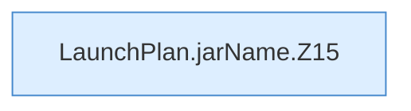

[[00 Start]] › [[Server-Anlage]] › [[Startplan]] › [[LaunchPlan]] › [[LaunchPlan.jarName]]

# LaunchPlan.jarName

`LaunchPlan.jarName(String type, String mc, String customJar)` [src/main/java/de/aichele/childlauncher/LaunchPlan.java:13–23](https://github.com/Sciddie/minecraft-serverhoster-plugin/blob/95b02b953b0b4c23673e900e021a7c3c844aa37d/src/main/java/de/aichele/childlauncher/LaunchPlan.java#L13-L23)



```knoten
LaunchPlan.jarName.Z15
  Der Ablauf geht in [[Glossar#Zeile|Zeile]] 15 weiter. Eine Ebene tiefer steht er genauer. Fortsetzung des Ablaufs ab Zeile 15.
```

> [!knoten]- Was die Blöcke tun
> - **LaunchPlan.jarName.Z15**: Der Ablauf geht in [[Glossar#Zeile|Zeile]] 15 weiter. Eine Ebene tiefer steht er genauer. Fortsetzung des Ablaufs ab Zeile 15.

- Dieser Teil kümmert sich um den Namen.
- `jarName` in `src/main/java/de/aichele/childlauncher/LaunchPlan.java`
