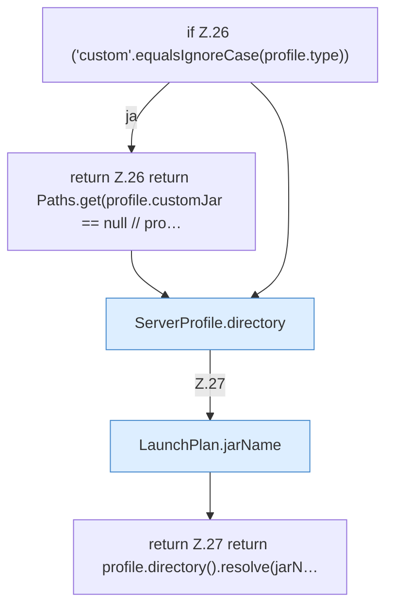

[[00 Start]] › [[Server-Anlage]] › [[Startplan]] › [[LaunchPlan]] › [[LaunchPlan.jarPath]]

# LaunchPlan.jarPath

`LaunchPlan.jarPath(ServerProfile profile)` [src/main/java/de/aichele/childlauncher/LaunchPlan.java:25–28](https://github.com/Sciddie/minecraft-serverhoster-plugin/blob/95b02b953b0b4c23673e900e021a7c3c844aa37d/src/main/java/de/aichele/childlauncher/LaunchPlan.java#L25-L28)

- `jarPath` in `src/main/java/de/aichele/childlauncher/LaunchPlan.java`
