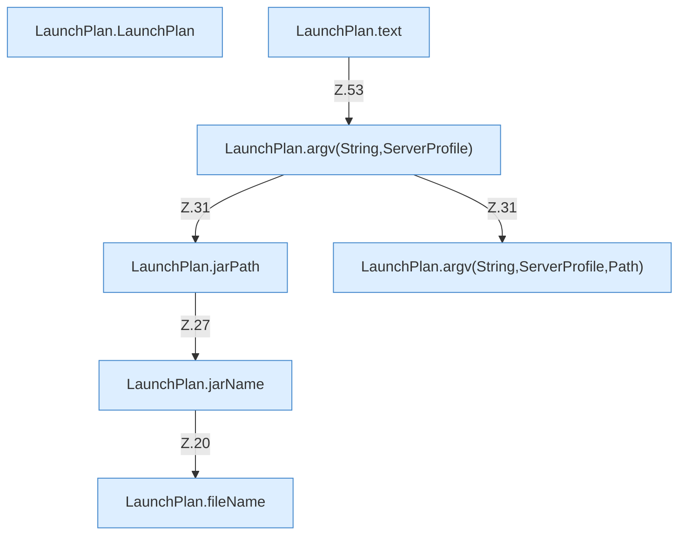

[[00 Start]] › [[Server-Anlage]] › [[Startplan]] › [[LaunchPlan]]

# LaunchPlan



```knoten
LaunchPlan.LaunchPlan
  Startet den Prozess `LaunchPlan`.
LaunchPlan.jarName
  Betrifft das Jar `jarName`. Ruft `fileName`.
LaunchPlan.jarPath
  Betrifft das Jar `jarPath`. Ruft `directory`, `jarName`.
LaunchPlan.argv(String,ServerProfile)
  `argv` in `LaunchPlan.java`. Ruft `argv`, `jarPath`.
LaunchPlan.argv(String,ServerProfile,Path)
  `argv` in `LaunchPlan.java`.
LaunchPlan.text
  Antwortet mit Text `text`. Ruft `argv`.
LaunchPlan.fileName
  Liefert die Datei `fileName`.
```


