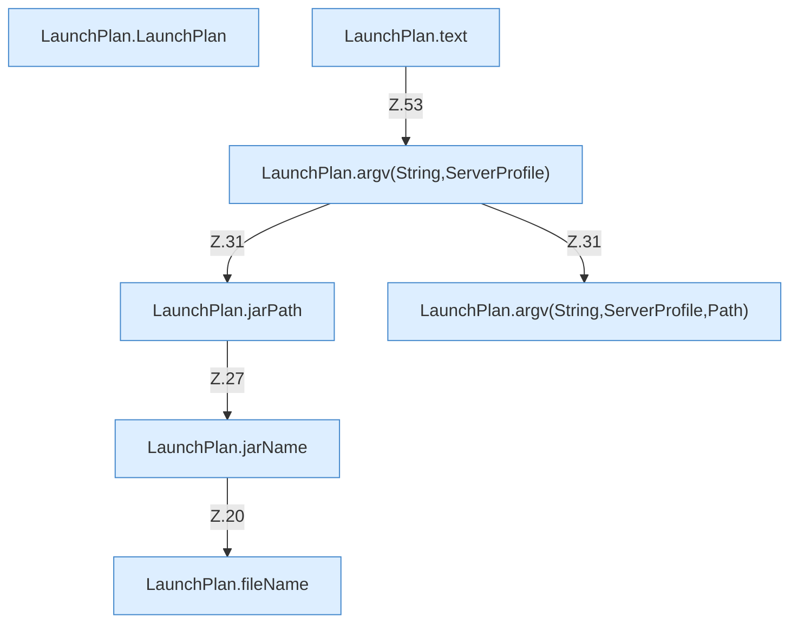

[[00 Start]] › [[Server-Anlage]] › [[Startplan]] › [[LaunchPlan]]

# LaunchPlan



```knoten
LaunchPlan.LaunchPlan
  Dieser Teil startet den [[Glossar#Startplan|Startplan]]. Im [[Glossar#Quelltext|Quelltext]] heißt das `LaunchPlan`.
LaunchPlan.jarName
  Dieser Teil kümmert sich um den Namen. Im [[Glossar#Quelltext|Quelltext]] heißt das `jarName`.
LaunchPlan.jarPath
  Dieser Teil kümmert sich um den Pfad. Im [[Glossar#Quelltext|Quelltext]] heißt das `jarPath`.
LaunchPlan.argv(String,ServerProfile)
  Dieser Teil macht hier einen einzelnen Schritt. Eine Ebene tiefer steht er genauer. Im [[Glossar#Quelltext|Quelltext]] heißt das `argv(String,ServerProfile)`.
LaunchPlan.argv(String,ServerProfile,Path)
  Dieser Teil macht hier einen einzelnen Schritt. Eine Ebene tiefer steht er genauer. Im [[Glossar#Quelltext|Quelltext]] heißt das `argv(String,ServerProfile,Path)`.
LaunchPlan.text
  Dieser Teil macht hier einen einzelnen Schritt. Eine Ebene tiefer steht er genauer. Im [[Glossar#Quelltext|Quelltext]] heißt das `text`.
LaunchPlan.fileName
  Dieser Teil kümmert sich um den Namen. Im [[Glossar#Quelltext|Quelltext]] heißt das `fileName`.
```

> [!knoten]- Was die Blöcke tun
> - **LaunchPlan.LaunchPlan**: Dieser Teil startet den [[Glossar#Startplan|Startplan]]. Im [[Glossar#Quelltext|Quelltext]] heißt das `LaunchPlan`.
> - **LaunchPlan.jarName**: Dieser Teil kümmert sich um den Namen. Im [[Glossar#Quelltext|Quelltext]] heißt das `jarName`.
> - **LaunchPlan.jarPath**: Dieser Teil kümmert sich um den Pfad. Im [[Glossar#Quelltext|Quelltext]] heißt das `jarPath`.
> - **LaunchPlan.argv(String,ServerProfile)**: Dieser Teil macht hier einen einzelnen Schritt. Eine Ebene tiefer steht er genauer. Im [[Glossar#Quelltext|Quelltext]] heißt das `argv(String,ServerProfile)`.
> - **LaunchPlan.argv(String,ServerProfile,Path)**: Dieser Teil macht hier einen einzelnen Schritt. Eine Ebene tiefer steht er genauer. Im [[Glossar#Quelltext|Quelltext]] heißt das `argv(String,ServerProfile,Path)`.
> - **LaunchPlan.text**: Dieser Teil macht hier einen einzelnen Schritt. Eine Ebene tiefer steht er genauer. Im [[Glossar#Quelltext|Quelltext]] heißt das `text`.
> - **LaunchPlan.fileName**: Dieser Teil kümmert sich um den Namen. Im [[Glossar#Quelltext|Quelltext]] heißt das `fileName`.

- Baut die Argumente, mit denen das Programm des [[Glossar#Spielserver|Spielservers]] gestartet wird.
