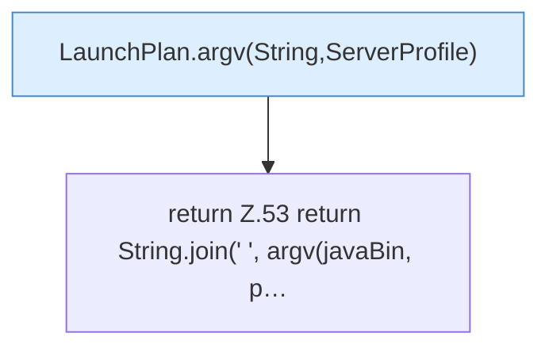

[[00 Start]] › [[Server-Anlage]] › [[Startplan]] › [[LaunchPlan]] › [[LaunchPlan.text]]

# LaunchPlan.text

`LaunchPlan.text(String javaBin, ServerProfile profile)` [src/main/java/de/aichele/childlauncher/LaunchPlan.java:52–54](https://github.com/Sciddie/minecraft-serverhoster-plugin/blob/95b02b953b0b4c23673e900e021a7c3c844aa37d/src/main/java/de/aichele/childlauncher/LaunchPlan.java#L52-L54)

- `text` in `src/main/java/de/aichele/childlauncher/LaunchPlan.java`
