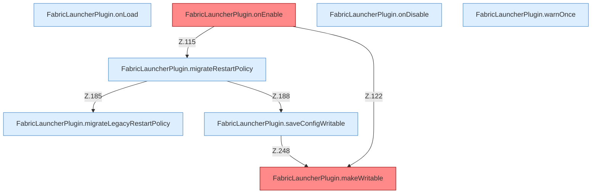

[[00 Start]] › [[Plugin-Kern]] › [[Lebenszyklus]]

# Lebenszyklus

- Spigot ruft `onLoad`, `onEnable`, `onDisable`.
- Threads: `ServerhosterPlugin`, `-Save`, `-Memory`, `-Supervisor`, `-ShutdownHook`.
