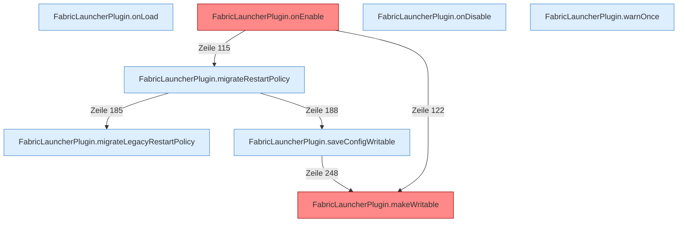

[[00 Start]] › [[Plugin-Kern]] › [[Lebenszyklus]]

# Lebenszyklus



```knoten
FabricLauncherPlugin.onLoad
  Läuft ganz am Anfang, noch bevor die Welten des [[Glossar#Host|Host]] geladen sind. Hier wird die Merkdatei der [[Glossar#Ersteinrichtung|Ersteinrichtung]] angeschaut.
FabricLauncherPlugin.onEnable
  Läuft, wenn der [[Glossar#Host|Host]] das [[Glossar#Plugin|Plugin]] einschaltet. [[Glossar#Einstellungen|Einstellungen]] werden gelesen, die [[Glossar#Wecker|Wecker]] starten, die [[Glossar#Bedienseite|Bedienseite]] geht auf. Auffällig: das kann sich anders verhalten, als man erwartet. Das nennt man [[Glossar#Unerwartetes Verhalten|Unerwartetes Verhalten]].
FabricLauncherPlugin.migrateRestartPolicy
  Übernimmt eine ältere Schreibweise der [[Glossar#Neustart|Neustart]]-Regel in die heutige.
FabricLauncherPlugin.migrateLegacyRestartPolicy
  Dasselbe für eine noch ältere Schreibweise der [[Glossar#Neustart|Neustart]]-Regel.
FabricLauncherPlugin.onDisable
  Läuft, wenn der [[Glossar#Host|Host]] das [[Glossar#Plugin|Plugin]] ausschaltet. Der [[Glossar#Spielserver|Spielserver]] wird gestoppt, die [[Glossar#Bedienseite|Bedienseite]] geht zu, laufende Arbeiten werden abgebrochen.
FabricLauncherPlugin.makeWritable
  Setzt die [[Glossar#Dateirechte|Dateirechte]] eines Ordners oder einer Datei sehr offen, damit der [[Glossar#Spielserver|Spielserver]] dort schreiben kann. Auffällig: das kann sich anders verhalten, als man erwartet. Das nennt man [[Glossar#Unerwartetes Verhalten|Unerwartetes Verhalten]].
FabricLauncherPlugin.saveConfigWritable
  Speichert die [[Glossar#Einstellungsdatei|Einstellungsdatei]] und setzt danach die [[Glossar#Dateirechte|Dateirechte]] so, dass sie beschreibbar bleibt.
FabricLauncherPlugin.warnOnce
  Schreibt eine Warnung nur ein einziges Mal, damit das Protokoll nicht vollläuft.
```

> [!knoten] Was die Blöcke tun
> - **FabricLauncherPlugin.onLoad**: Läuft ganz am Anfang, noch bevor die Welten des [[Glossar#Host|Host]] geladen sind. Hier wird die Merkdatei der [[Glossar#Ersteinrichtung|Ersteinrichtung]] angeschaut.
> - **FabricLauncherPlugin.onEnable**: Läuft, wenn der [[Glossar#Host|Host]] das [[Glossar#Plugin|Plugin]] einschaltet. [[Glossar#Einstellungen|Einstellungen]] werden gelesen, die [[Glossar#Wecker|Wecker]] starten, die [[Glossar#Bedienseite|Bedienseite]] geht auf. Auffällig: das kann sich anders verhalten, als man erwartet. Das nennt man [[Glossar#Unerwartetes Verhalten|Unerwartetes Verhalten]].
> - **FabricLauncherPlugin.migrateRestartPolicy**: Übernimmt eine ältere Schreibweise der [[Glossar#Neustart|Neustart]]-Regel in die heutige.
> - **FabricLauncherPlugin.migrateLegacyRestartPolicy**: Dasselbe für eine noch ältere Schreibweise der [[Glossar#Neustart|Neustart]]-Regel.
> - **FabricLauncherPlugin.onDisable**: Läuft, wenn der [[Glossar#Host|Host]] das [[Glossar#Plugin|Plugin]] ausschaltet. Der [[Glossar#Spielserver|Spielserver]] wird gestoppt, die [[Glossar#Bedienseite|Bedienseite]] geht zu, laufende Arbeiten werden abgebrochen.
> - **FabricLauncherPlugin.makeWritable**: Setzt die [[Glossar#Dateirechte|Dateirechte]] eines Ordners oder einer Datei sehr offen, damit der [[Glossar#Spielserver|Spielserver]] dort schreiben kann. Auffällig: das kann sich anders verhalten, als man erwartet. Das nennt man [[Glossar#Unerwartetes Verhalten|Unerwartetes Verhalten]].
> - **FabricLauncherPlugin.saveConfigWritable**: Speichert die [[Glossar#Einstellungsdatei|Einstellungsdatei]] und setzt danach die [[Glossar#Dateirechte|Dateirechte]] so, dass sie beschreibbar bleibt.
> - **FabricLauncherPlugin.warnOnce**: Schreibt eine Warnung nur ein einziges Mal, damit das Protokoll nicht vollläuft.

- Was passiert, wenn der [[Glossar#Host|Host]] das [[Glossar#Plugin|Plugin]] lädt, einschaltet und wieder ausschaltet. Hier starten auch die [[Glossar#Wecker|Wecker]].
