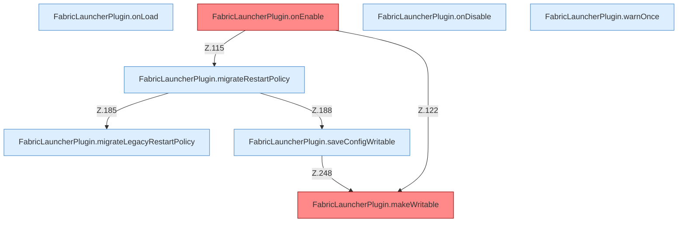

[[00 Start]] › [[Plugin-Kern]] › [[Lebenszyklus]]

# Lebenszyklus



```knoten
FabricLauncherPlugin.onLoad
  Spigot `onLoad`: Marker `HostFirstSetup`, bevor Welten laden.
FabricLauncherPlugin.onEnable
  Spigot `onEnable`: Profile, Sampler, Dashboard, fünf Scheduler. Befund: Logikrisiko (sicher).
FabricLauncherPlugin.migrateRestartPolicy
  Übernimmt den alten Wert von `migrateRestartPolicy`. Ruft `migrateLegacyUnlimited`, `migrateLegacyRestartPolicy`, `saveConfigWritable`.
FabricLauncherPlugin.migrateLegacyRestartPolicy
  Übernimmt den alten Wert von `migrateLegacyRestartPolicy`. Ruft `migrateLegacyUnlimited`.
FabricLauncherPlugin.onDisable
  Spigot `onDisable`: Child stoppen, Dashboard stoppen, Pool `shutdownNow`.
FabricLauncherPlugin.makeWritable
  Setzt POSIX `rwxrwxrwx` für Ordner und `rw-rw-rw-` für Dateien. Befund: Logikrisiko (sicher).
FabricLauncherPlugin.saveConfigWritable
  Speichert `saveConfigWritable`. Ruft `makeWritable`.
FabricLauncherPlugin.warnOnce
  Warnt `warnOnce`.
```

- Spigot ruft `onLoad`, `onEnable`, `onDisable`.
- Threads: `ServerhosterPlugin`, `-Save`, `-Memory`, `-Supervisor`, `-ShutdownHook`.
