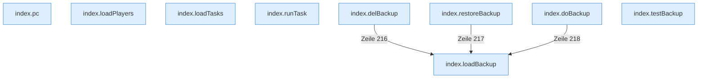

[[00 Start]] › [[Dashboard-UI]] › [[Legacy-Altlast]]

# Legacy-Altlast



```knoten
index.pc
  Schickt von der älteren [[Glossar#Bedienseite|Bedienseite]] einen [[Glossar#Befehl|Befehl]], der einen [[Glossar#Spieler|Spieler]] betrifft.
index.loadPlayers
  Die ältere [[Glossar#Bedienseite|Bedienseite]] lädt die [[Glossar#Spieler|Spieler]].
index.loadTasks
  Die ältere [[Glossar#Bedienseite|Bedienseite]] lädt die [[Glossar#Aufgabe|Aufgaben]].
index.runTask
  Die ältere [[Glossar#Bedienseite|Bedienseite]] führt aus die [[Glossar#Aufgabe|Aufgabe]].
index.loadBackup
  Die ältere [[Glossar#Bedienseite|Bedienseite]] lädt die [[Glossar#Sicherungskopie|Sicherungskopie]].
index.delBackup
  Die ältere [[Glossar#Bedienseite|Bedienseite]] löscht die [[Glossar#Sicherungskopie|Sicherungskopie]].
index.restoreBackup
  Die ältere [[Glossar#Bedienseite|Bedienseite]] stellt wieder her die [[Glossar#Sicherungskopie|Sicherungskopie]].
index.doBackup
  Die ältere [[Glossar#Bedienseite|Bedienseite]] führt aus die [[Glossar#Sicherungskopie|Sicherungskopie]].
index.testBackup
  Die ältere [[Glossar#Bedienseite|Bedienseite]] prüft die [[Glossar#Sicherungskopie|Sicherungskopie]].
```

> [!knoten] Was die Blöcke tun
> - **index.pc**: Schickt von der älteren [[Glossar#Bedienseite|Bedienseite]] einen [[Glossar#Befehl|Befehl]], der einen [[Glossar#Spieler|Spieler]] betrifft.
> - **index.loadPlayers**: Die ältere [[Glossar#Bedienseite|Bedienseite]] lädt die [[Glossar#Spieler|Spieler]].
> - **index.loadTasks**: Die ältere [[Glossar#Bedienseite|Bedienseite]] lädt die [[Glossar#Aufgabe|Aufgaben]].
> - **index.runTask**: Die ältere [[Glossar#Bedienseite|Bedienseite]] führt aus die [[Glossar#Aufgabe|Aufgabe]].
> - **index.loadBackup**: Die ältere [[Glossar#Bedienseite|Bedienseite]] lädt die [[Glossar#Sicherungskopie|Sicherungskopie]].
> - **index.delBackup**: Die ältere [[Glossar#Bedienseite|Bedienseite]] löscht die [[Glossar#Sicherungskopie|Sicherungskopie]].
> - **index.restoreBackup**: Die ältere [[Glossar#Bedienseite|Bedienseite]] stellt wieder her die [[Glossar#Sicherungskopie|Sicherungskopie]].
> - **index.doBackup**: Die ältere [[Glossar#Bedienseite|Bedienseite]] führt aus die [[Glossar#Sicherungskopie|Sicherungskopie]].
> - **index.testBackup**: Die ältere [[Glossar#Bedienseite|Bedienseite]] prüft die [[Glossar#Sicherungskopie|Sicherungskopie]].

- Bereiche der älteren [[Glossar#Bedienseite|Bedienseite]], die die neuere Seite aus dem laufenden Text herausschneidet. Sie bleiben in der Datei, laufen aber nicht mit.
