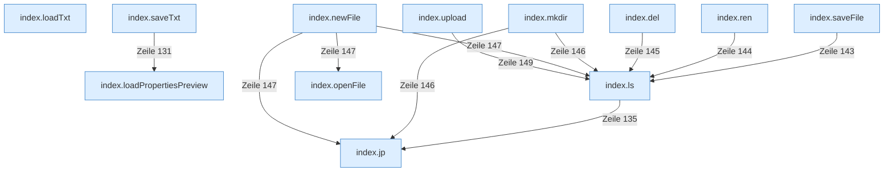

[[00 Start]] › [[Dashboard-UI]] › [[Legacy-Dateien]]

# Legacy-Dateien



```knoten
index.loadTxt
  Die ältere [[Glossar#Bedienseite|Bedienseite]] lädt den Text.
index.saveTxt
  Die ältere [[Glossar#Bedienseite|Bedienseite]] speichert den Text.
index.loadPropertiesPreview
  Die ältere [[Glossar#Bedienseite|Bedienseite]] lädt die Eigenschaften die Vorschau.
index.jp
  Baut in der älteren [[Glossar#Bedienseite|Bedienseite]] einen Dateipfad aus seinen Teilen.
index.ls
  Zeigt in der älteren [[Glossar#Bedienseite|Bedienseite]] den Inhalt eines Ordners.
index.openFile
  Die ältere [[Glossar#Bedienseite|Bedienseite]] öffnet die Datei.
index.saveFile
  Die ältere [[Glossar#Bedienseite|Bedienseite]] speichert die Datei.
index.ren
  Benennt in der älteren [[Glossar#Bedienseite|Bedienseite]] eine Datei um.
index.del
  Löscht in der älteren [[Glossar#Bedienseite|Bedienseite]] eine Datei.
index.mkdir
  Legt in der älteren [[Glossar#Bedienseite|Bedienseite]] einen Ordner an.
index.newFile
  Legt in der älteren [[Glossar#Bedienseite|Bedienseite]] eine neue Datei an.
index.upload
  Schickt eine Datei von der älteren [[Glossar#Bedienseite|Bedienseite]] an das [[Glossar#Plugin|Plugin]].
```

> [!knoten] Was die Blöcke tun
> - **index.loadTxt**: Die ältere [[Glossar#Bedienseite|Bedienseite]] lädt den Text.
> - **index.saveTxt**: Die ältere [[Glossar#Bedienseite|Bedienseite]] speichert den Text.
> - **index.loadPropertiesPreview**: Die ältere [[Glossar#Bedienseite|Bedienseite]] lädt die Eigenschaften die Vorschau.
> - **index.jp**: Baut in der älteren [[Glossar#Bedienseite|Bedienseite]] einen Dateipfad aus seinen Teilen.
> - **index.ls**: Zeigt in der älteren [[Glossar#Bedienseite|Bedienseite]] den Inhalt eines Ordners.
> - **index.openFile**: Die ältere [[Glossar#Bedienseite|Bedienseite]] öffnet die Datei.
> - **index.saveFile**: Die ältere [[Glossar#Bedienseite|Bedienseite]] speichert die Datei.
> - **index.ren**: Benennt in der älteren [[Glossar#Bedienseite|Bedienseite]] eine Datei um.
> - **index.del**: Löscht in der älteren [[Glossar#Bedienseite|Bedienseite]] eine Datei.
> - **index.mkdir**: Legt in der älteren [[Glossar#Bedienseite|Bedienseite]] einen Ordner an.
> - **index.newFile**: Legt in der älteren [[Glossar#Bedienseite|Bedienseite]] eine neue Datei an.
> - **index.upload**: Schickt eine Datei von der älteren [[Glossar#Bedienseite|Bedienseite]] an das [[Glossar#Plugin|Plugin]].

- Der Datei-Browser in der älteren [[Glossar#Bedienseite|Bedienseite]].
