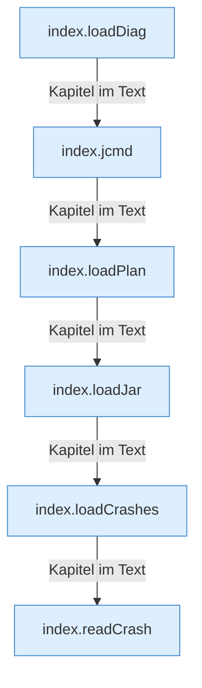

[[00 Start]] › [[Dashboard-UI]] › [[Legacy-Diag]]

# Legacy-Diag



```knoten
index.loadDiag
  Die ältere [[Glossar#Bedienseite|Bedienseite]] lädt die [[Glossar#Diagnose|Diagnose]].
index.jcmd
  Die ältere [[Glossar#Bedienseite|Bedienseite]] macht hier einen einzelnen Schritt. Eine Ebene tiefer steht er genauer.
index.loadPlan
  Die ältere [[Glossar#Bedienseite|Bedienseite]] lädt den [[Glossar#Startplan|Startplan]].
index.loadJar
  Die ältere [[Glossar#Bedienseite|Bedienseite]] lädt die [[Glossar#Programmdatei|Programmdatei]].
index.loadCrashes
  Die ältere [[Glossar#Bedienseite|Bedienseite]] lädt die [[Glossar#Absturzbericht|Absturzberichte]].
index.readCrash
  Die ältere [[Glossar#Bedienseite|Bedienseite]] liest den [[Glossar#Absturzbericht|Absturzbericht]].
```

> [!knoten] Was die Blöcke tun
> - **index.loadDiag**: Die ältere [[Glossar#Bedienseite|Bedienseite]] lädt die [[Glossar#Diagnose|Diagnose]].
> - **index.jcmd**: Die ältere [[Glossar#Bedienseite|Bedienseite]] macht hier einen einzelnen Schritt. Eine Ebene tiefer steht er genauer.
> - **index.loadPlan**: Die ältere [[Glossar#Bedienseite|Bedienseite]] lädt den [[Glossar#Startplan|Startplan]].
> - **index.loadJar**: Die ältere [[Glossar#Bedienseite|Bedienseite]] lädt die [[Glossar#Programmdatei|Programmdatei]].
> - **index.loadCrashes**: Die ältere [[Glossar#Bedienseite|Bedienseite]] lädt die [[Glossar#Absturzbericht|Absturzberichte]].
> - **index.readCrash**: Die ältere [[Glossar#Bedienseite|Bedienseite]] liest den [[Glossar#Absturzbericht|Absturzbericht]].

- Die Diagnosekarten in der älteren [[Glossar#Bedienseite|Bedienseite]].
