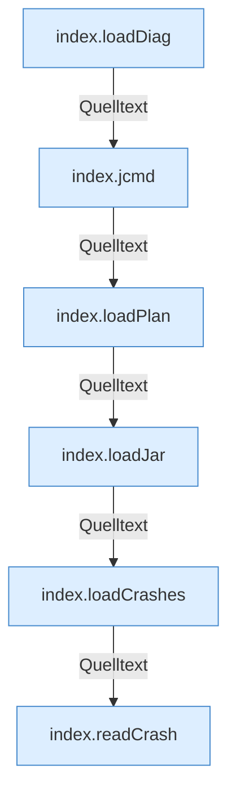

[[00 Start]] › [[Dashboard-UI]] › [[Legacy-Diag]]

# Legacy-Diag



```knoten
index.loadDiag
  Lädt `loadDiag`. Ruft `api`, `$`, `row`.
index.jcmd
  `jcmd` in `index.html`. Ruft `post`, `$`.
index.loadPlan
  Lädt `loadPlan`. Ruft `$`, `api`.
index.loadJar
  Lädt `loadJar`. Ruft `api`, `$`.
index.loadCrashes
  Lädt `loadCrashes`. Ruft `api`, `$`, `esc`.
index.readCrash
  Liest `readCrash`. Ruft `$`, `toast`, `api`.
```


