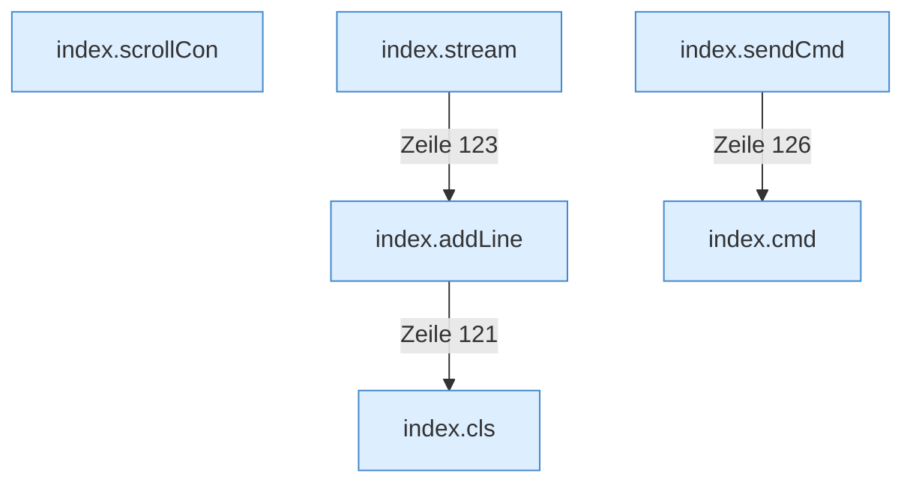

[[00 Start]] › [[Dashboard-UI]] › [[Legacy-Konsole]]

# Legacy-Konsole



```knoten
index.cls
  Leert die Anzeige der [[Glossar#Konsole|Konsole]] in der älteren [[Glossar#Bedienseite|Bedienseite]].
index.addLine
  Die ältere [[Glossar#Bedienseite|Bedienseite]] fügt hinzu eine [[Glossar#Zeile|Zeile]].
index.scrollCon
  Die ältere [[Glossar#Bedienseite|Bedienseite]] rollt die [[Glossar#Konsole|Konsole]].
index.stream
  Hält die Verbindung offen, damit neue Konsolenzeilen von selbst nachkommen.
index.cmd
  Schickt einen [[Glossar#Befehl|Befehl]] aus der älteren [[Glossar#Bedienseite|Bedienseite]] an den [[Glossar#Spielserver|Spielserver]].
index.sendCmd
  Die ältere [[Glossar#Bedienseite|Bedienseite]] schickt einen [[Glossar#Befehl|Befehl]].
```

> [!knoten] Was die Blöcke tun
> - **index.cls**: Leert die Anzeige der [[Glossar#Konsole|Konsole]] in der älteren [[Glossar#Bedienseite|Bedienseite]].
> - **index.addLine**: Die ältere [[Glossar#Bedienseite|Bedienseite]] fügt hinzu eine [[Glossar#Zeile|Zeile]].
> - **index.scrollCon**: Die ältere [[Glossar#Bedienseite|Bedienseite]] rollt die [[Glossar#Konsole|Konsole]].
> - **index.stream**: Hält die Verbindung offen, damit neue Konsolenzeilen von selbst nachkommen.
> - **index.cmd**: Schickt einen [[Glossar#Befehl|Befehl]] aus der älteren [[Glossar#Bedienseite|Bedienseite]] an den [[Glossar#Spielserver|Spielserver]].
> - **index.sendCmd**: Die ältere [[Glossar#Bedienseite|Bedienseite]] schickt einen [[Glossar#Befehl|Befehl]].

- [[Glossar#Konsole|Konsole]] und Befehlszeile in der älteren [[Glossar#Bedienseite|Bedienseite]].
