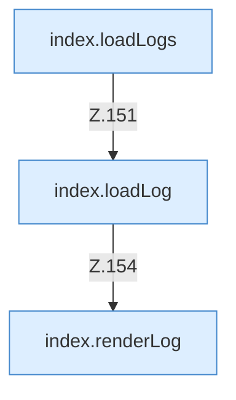

[[00 Start]] › [[Dashboard-UI]] › [[Legacy-Logs]]

# Legacy-Logs



```knoten
index.loadLogs
  Lädt `loadLogs`. Ruft `api`, `$`, `esc`.
index.loadLog
  Lädt `loadLog`. Ruft `$`, `api`, `renderLog`.
index.renderLog
  Zeichnet `renderLog`. Ruft `$`, `cls`.
```


