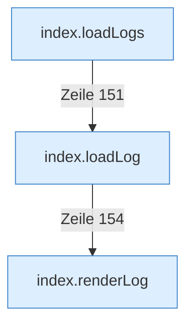

[[00 Start]] › [[Dashboard-UI]] › [[Legacy-Logs]]

# Legacy-Logs



```knoten
index.loadLogs
  Die ältere [[Glossar#Bedienseite|Bedienseite]] lädt die Protokolle.
index.loadLog
  Die ältere [[Glossar#Bedienseite|Bedienseite]] lädt das Protokoll.
index.renderLog
  Die ältere [[Glossar#Bedienseite|Bedienseite]] zeichnet das Protokoll.
```

> [!knoten] Was die Blöcke tun
> - **index.loadLogs**: Die ältere [[Glossar#Bedienseite|Bedienseite]] lädt die Protokolle.
> - **index.loadLog**: Die ältere [[Glossar#Bedienseite|Bedienseite]] lädt das Protokoll.
> - **index.renderLog**: Die ältere [[Glossar#Bedienseite|Bedienseite]] zeichnet das Protokoll.

- Die Protokollansicht in der älteren [[Glossar#Bedienseite|Bedienseite]].
